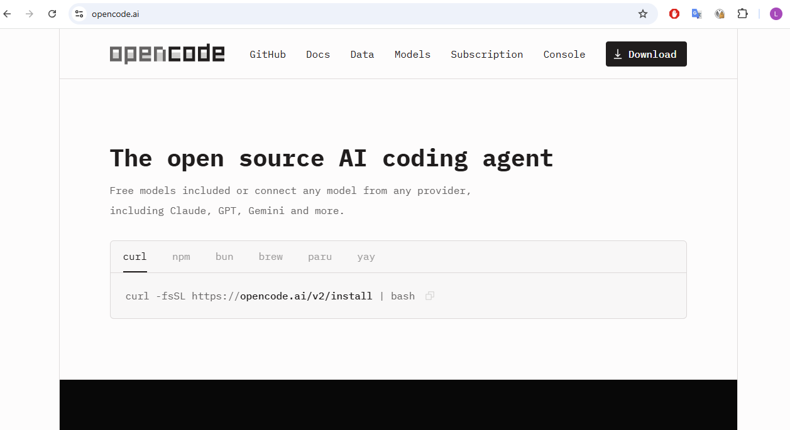
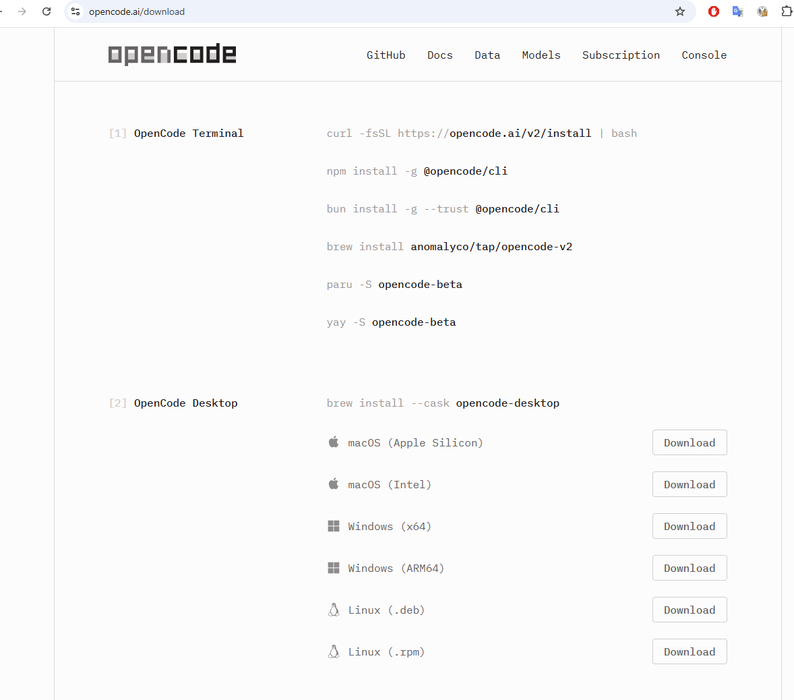
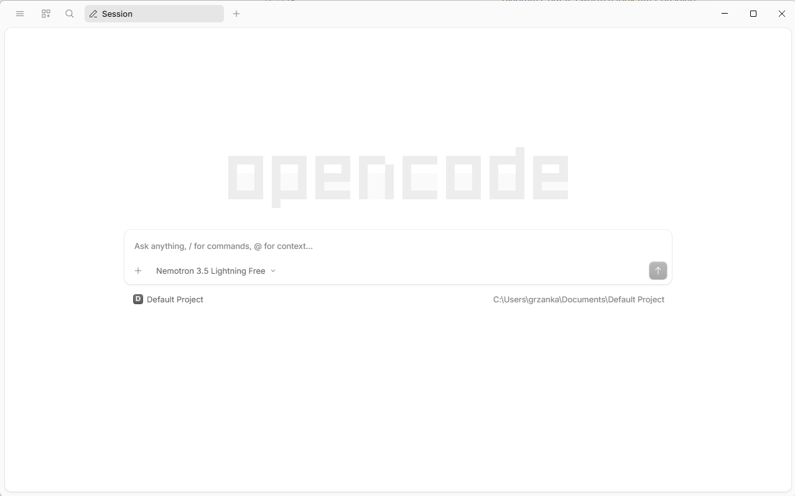

# 2. Install the opencode app

Open your web browser and go to <https://opencode.ai/>.

> [!WARNING]
> Do **not** run the command shown on the home page
> (`curl -fsSL https://opencode.ai/v2/install | bash`), or any other command
> from the list. They install the **terminal** version of opencode. We use the
> **desktop** app.

Click **Download** in the top right corner. The download page has two parts.
Skip **[1] OpenCode Terminal**. Go to **[2] OpenCode Desktop** and click
**Download** in the row for your computer:

| Your computer | Row to choose |
|---|---|
| Most Windows laptops and desktops | **Windows (x64)** |
| Windows on a Snapdragon processor (some laptops from 2024 on) | **Windows (ARM64)** |
| Mac from late 2020 on, with an M1, M2, M3, M4… chip | **macOS (Apple Silicon)** |
| Older Mac with an Intel processor | **macOS (Intel)** |
| Ubuntu, Debian, Linux Mint | **Linux (.deb)** |
| Fedora, Red Hat, openSUSE | **Linux (.rpm)** |

Not sure which one you have? Read the two explanations below.

Open the downloaded file and follow the installer.

- **Windows:** the file is in your *Downloads* folder. Double-click it. If you see
  *Windows protected your PC*, check that you downloaded the file from
  opencode.ai, then click **More info → Run anyway**.
- **macOS:** open the downloaded file and drag opencode into *Applications*.
- **Linux:** open the file with your software installer, or install it from the
  terminal with your package manager.

Start the app: press the **Windows** key, type `opencode`, and press **Enter**.
On macOS, open it from Launchpad; on Linux, from the application menu.

Expected result: a window like this, with the large **opencode** logo and a
text box that says *Ask anything, / for commands, @ for context...*:

- Under the text box you see a free model run by opencode (here *Nemotron 3.5
  Lightning Free*; yours may differ). It is not llmlab yet: pages 3 and 4 change
  that.
- Below it you see the project, **Default Project**, the folder opencode works in.

Explain: Apple Silicon or Intel (Mac)?

The processor is the chip that runs all programs. A program is built for one
type of processor, so you need the matching download.

From 2006 to 2020, every Mac had an **Intel** processor, the same kind as in
most Windows PCs. In November 2020 Apple started to use its own chips, called
**Apple Silicon**: M1, then M2, M3, M4 and newer. They are related to the chips
in iPhones. By 2023 every new Mac had one. A MacBook Air bought in 2021 has an
M1 chip; a MacBook Pro from 2019 has an Intel processor.

To check: click the **Apple menu** in the top left corner, then **About This
Mac**. If you see *Chip: Apple M…*, choose **Apple Silicon**. If you see
*Processor: … Intel Core i5* (or i7, i9), choose **Intel**.

Explain: x64 or ARM64 (Windows)?

These are two families of processors.

- **x64** (also called x86-64 or AMD64) is the family of Intel and AMD
  processors, for example *Intel Core i5* or *AMD Ryzen 7*. It goes back to the
  first PC processors of the 1980s (Intel 8086, hence "x86"); AMD extended it to
  64 bits in 2003. Almost all Windows computers use it.
- **ARM64** is the family used in phones and tablets. It uses less power, so the
  battery lasts longer. Windows laptops with ARM processors became common in
  2024 with the **Qualcomm Snapdragon X** chips, in "Copilot+ PC" models such as
  Microsoft Surface Laptop 7 or some Lenovo, Dell, HP and ASUS laptops.

To check: open **Settings → System → About** and look at **System type**. It
says *x64-based processor* or *ARM-based processor*. If you are not sure, choose
**x64**: ARM laptops can run x64 programs too, only a bit slower.

## Sources

- opencode download page: <https://opencode.ai/download>

---

← Previous: [1. Chatbot or agent](01-chatbot-or-agent.md) · [Overview](README.md) · Next: [3. Configure opencode for llmlab, part 1: the address →](03-configure-llmlab-endpoint.md)
