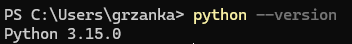
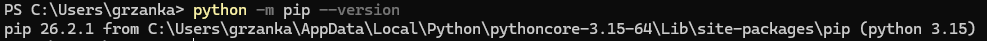
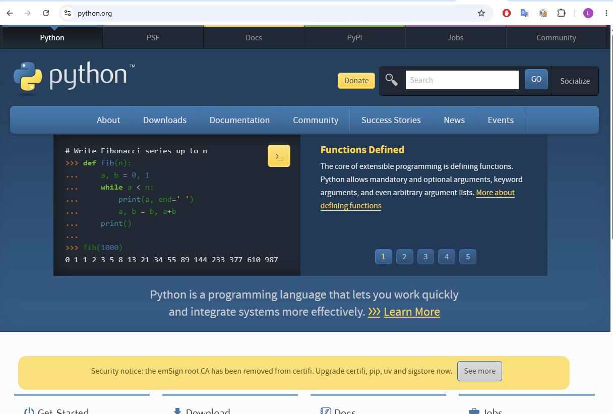

# Before the exercises: check that Python is installed

In the exercises the agent writes small **Python** programs and runs them on your
computer. For that, Python must be installed. You do not need to know Python;
the agent writes the code.

Do this once, before the first exercise. It takes 2 minutes if Python is already
there, and about 10 minutes if you need to install it.

## Step 1. Open PowerShell

Press the **Windows** key, type `PowerShell`, and press **Enter**.

## Step 2. Check Python

```powershell
python --version
```

Expected result: one line with the version, for example `Python 3.15.0`. Any
version from **3.10** up is fine. Go on with step 3.



If instead you see one of these, Python is missing. Go to
[Install Python](#install-python):

- *Python was not found; run without arguments to install from the Microsoft
  Store...*
- *python : The term 'python' is not recognized...*
- the **Microsoft Store** opens on a Python page. Close it: in this course we
  install Python from python.org, not from the Store.

<details>
<summary>Explain: why does Windows open the Microsoft Store?</summary>

Windows has a placeholder called `python` that only points to the Microsoft
Store. It is not Python itself. When you install Python from python.org (below),
the real `python` takes over.

</details>

## Step 3. Check pip

pip is the tool that installs extra Python packages, for example for plots. The
agent uses it in the exercises.

```powershell
python -m pip --version
```

Expected result: one line that starts with `pip` and a version number, then the
folder it lives in and the Python version in brackets.



If both steps worked, you are ready: go to
[Create a project folder](01-project-folder.md).

## Install Python

Install the newest Python, **3.15**, from the official website.

### 1. Open python.org

Open your web browser and go to <https://www.python.org>. Point at
**Downloads** in the blue menu.



### 2. Download

The page recognises Windows and offers a big yellow button,
**Download Python install manager**. Click it and save the file.

<!-- TODO: screenshot of the Downloads menu and of the install manager window. -->

### 3. Run the installer

Open the downloaded file (from the browser's download list, or from the
**Downloads** folder) and click **Install**.

### 4. Install Python itself

The install manager is a small helper; Python itself comes with the first use.
**Close PowerShell and open a new one**: a window that was already open does not
know about the new program. Then run step 2 again:

```powershell
python --version
```

The first time, the install manager downloads the newest Python, which takes a
minute. It may ask in the window whether to add a folder to your **PATH** (the
list of places where Windows looks for programs). Type `y` and press **Enter**.

Expected result: `Python 3.15.0` or newer, as in the picture in step 2. Then
repeat step 3.

If opencode was open, close it and start it again too, for the same reason as
PowerShell.

<details>
<summary>Explain: what is the install manager?</summary>

Until 2025 python.org offered one installer per Python version. Since Python
3.14 the main download is the **Python install manager**: one small program that
installs, updates and removes Python versions for you. It also gives you the
command `py`. For example, `py list` shows the installed versions, and
`py install 3.15` installs version 3.15.

Python goes into your user folder, `C:\Users\yourname\AppData\Local\Python`.
That is why the pip line in step 3 shows a path with `pythoncore-3.15-64`.

</details>

<details>
<summary>Prefer the classic installer?</summary>

Under the yellow button there is a link *Or get the standalone installer for
Python 3.15...*. Download it and run it. On the first screen, tick
**Add python.exe to PATH** before you click **Install Now**. Without that tick,
`python --version` still fails. Then open a new PowerShell and repeat steps 2
and 3.

The classic installer is still offered for 3.15, but it will not be made for
Python 3.16 and later.

</details>

<details>
<summary>Going further: install with winget</summary>

If you are used to the command line, winget, the program installer built into
Windows 10 and 11, installs the same Python install manager from python.org:

```powershell
winget install -e --id Python.PythonInstallManager
```

Then continue with [install step 4](#4-install-python-itself).

</details>

<details>
<summary>Linux / macOS</summary>

Use `python3` instead of `python`:

```bash
python3 --version
```

```bash
python3 -m pip --version
```

To install: on Ubuntu or Debian, install the packages `python3`, `python3-pip`
and `python3-venv` with `sudo apt install`. On macOS, download the macOS
installer from <https://www.python.org/downloads/> and run it.

</details>

<details>
<summary>Errors</summary>

- `python --version` still fails after installing: you did not open a **new**
  PowerShell window. Close all of them and open a new one.
- `python --version` still opens the Microsoft Store: the PATH question in
  install step 4 was answered with no. Run `py --version`; if that works, ask
  the agent to use `py` instead of `python`, or reinstall and answer `y`.
- *No module named pip*: run `python -m ensurepip`, then step 3 again.
- You are on a university or company computer and cannot install programs: ask
  your IT department to install Python 3, or use a personal computer for the
  exercises.

</details>

---

← Previous: [5. First steps in opencode](../01-getting-started/05-first-steps.md) · [Overview](README.md) · Next: [Create a project folder →](01-project-folder.md)
