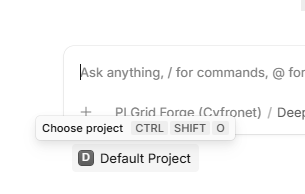
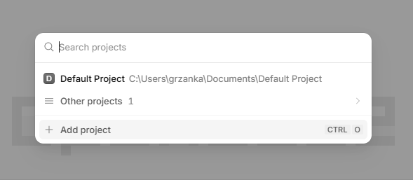
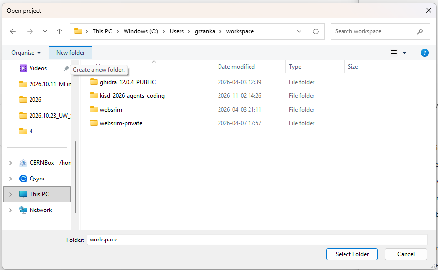
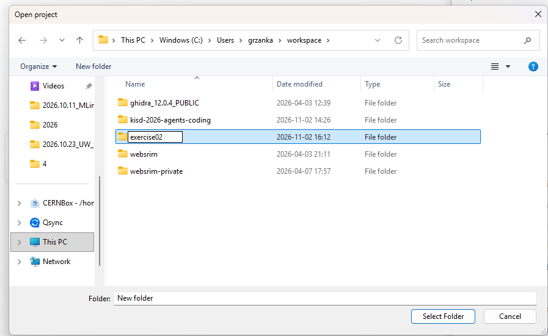
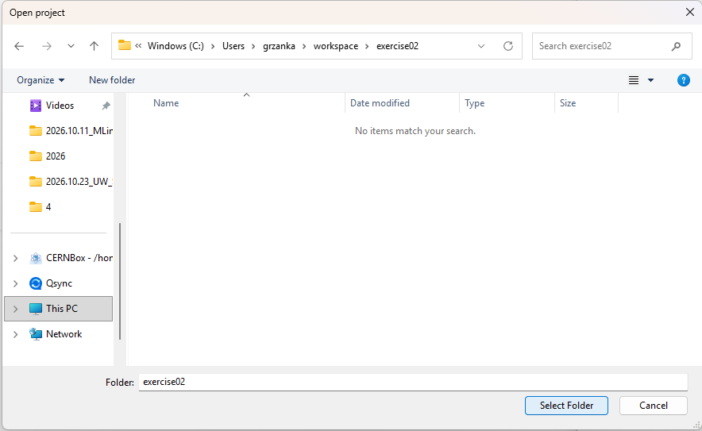
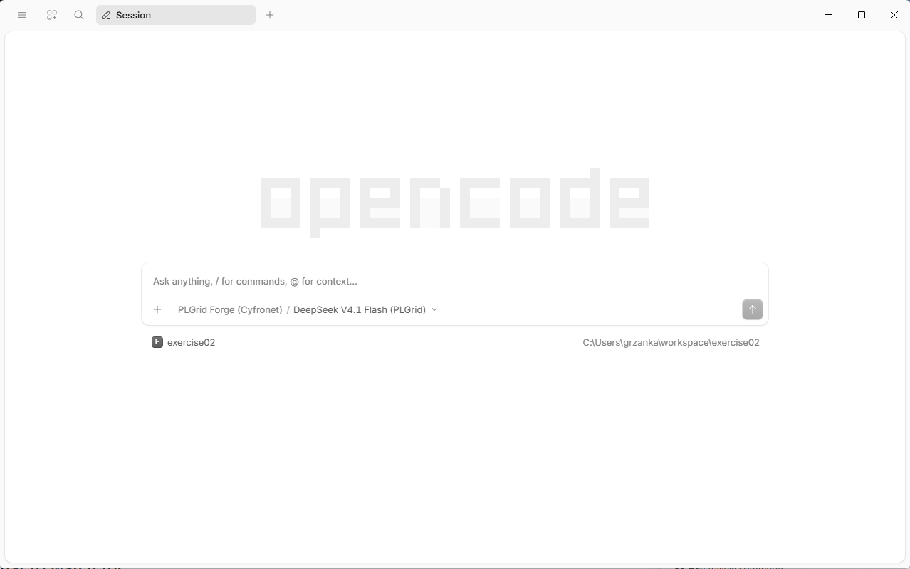
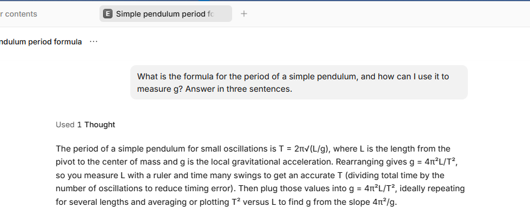
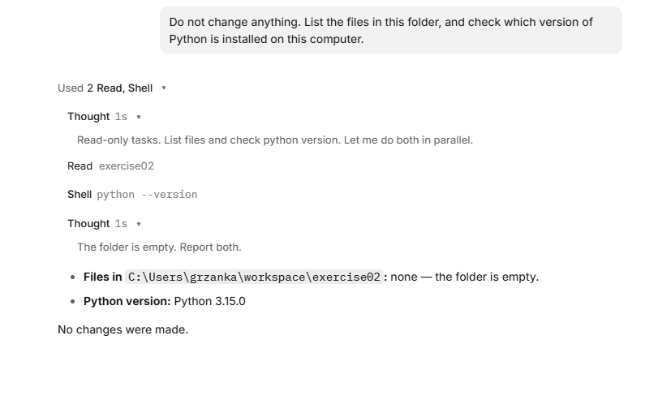
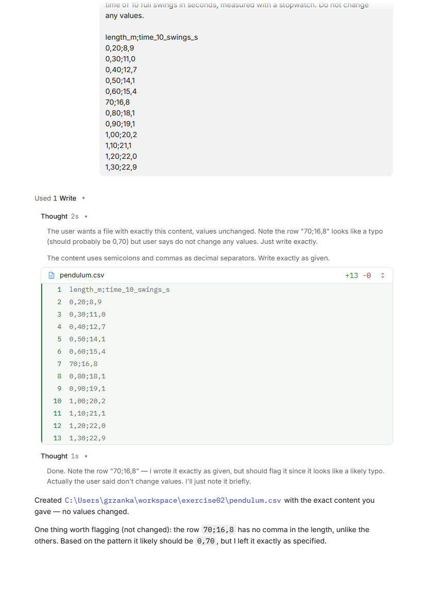
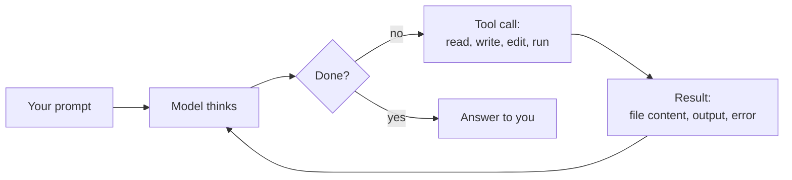

# Exercise 1: Your first agent session — measuring *g* with a pendulum

In a chat (ChatGPT, Copilot chat, the llmlab web page) you ask, the model
answers, and **you** copy the code, run it, and paste the errors back. An agent
does that loop **itself**: it writes files, runs them, reads the output, and
fixes what went wrong.

In this exercise you watch that happen on a small physics task. A student lab
measured how long pendulums of different lengths take to swing. From that you
compute the gravitational acceleration *g* (about 9.81 m/s²). The data has two
traps in it, as real lab data often does. You will see how the agent deals with
them.

You do **not** need to write or read any Python. You only type prompts and
watch.

- Time: about 30–40 minutes.
- You need: the opencode app connected to llmlab (pages 2–4 of
  [Getting started](../01-getting-started/README.md)), and Python installed
  ([Before the exercises](00-prerequisites.md)).

<details>
<summary>Explain: agent, tool, tool call, agentic loop</summary>

- **Model**: the program that reads text and writes text. On its own it cannot
  see your computer.
- **Tool**: an action the agent offers the model: read a file, write a file, edit
  a file, run a command in the terminal.
- **Tool call**: the model asks for one of those actions, for example "run
  `python analyse.py`". The agent carries it out and sends the result back to the
  model.
- **Agentic loop**: the model thinks, calls a tool, looks at the result, and
  decides what to do next. It repeats this until the task is done, then answers
  you.

</details>

## What to watch for

Above each answer, opencode shows a summary line such as *Used 2 Read, Shell*.
Click it (the small ▾) to open the details: each tool call on its own line, with
the tool name and its target. The tools you will see:

- **Read** (also *List* or *Glob*): the agent looks at files or folders.
- **Write**: the agent creates a new file. opencode shows its content with the
  new lines in green.
- **Edit**: the agent changes part of an existing file. opencode shows the change
  in red (removed) and green (added).
- **Shell**: the agent runs a command in the terminal and reads its output.

You will also see **Thought**: the model thinking before it acts. It is not a
tool call; nothing happens on your computer.

After each step below, count which tools you saw. That is the whole point of the
exercise.

If opencode asks for **permission** before a tool call, read what it wants to do,
then approve it.

## Step 0: Create a project folder

You may be used to working with **one file at a time**: you open a Word document,
edit it, save it. An agent works differently. It works with a **whole folder**,
called the **project**. It can read, create and change every file in that folder,
and nothing outside it. Over the exercise the agent fills the folder with several
files: the data, a script, a plot and a report.

So the rule is: **one project = one folder**. Each exercise gets its own new,
empty folder. That keeps the files of different exercises apart, and keeps the
agent away from your other files.

You create the folder from inside opencode.

### 0a. Choose a project

Start the opencode app (press the **Windows** key, type `opencode`, press
**Enter**). Under the text box you see the current project, after installing it
is **Default Project**. Click it, or press **Ctrl+Shift+O**.



### 0b. Add a project

A list of projects opens. Click **Add project** (or press **Ctrl+O**).



### 0c. Create a new folder

A window **Open project** opens. It looks like File Explorer. Go to the place
where you want to keep your exercises, for example **Documents**: click
**This PC** on the left, then **Documents**. Then click **New folder** at the top.



### 0d. Name the folder

A new folder appears, with its name ready to type over. Type `kisd-pendulum` and
press **Enter**. (In the picture the folder is called `exercise02`; use
`kisd-pendulum`.)



### 0e. Open the folder and select it

Double-click the new folder to go into it. It is empty, so the window says
*No items match your search*. That is fine. Click **Select Folder**.



Expected result: opencode shows the new project under the text box, with its
full path on the right, and the model **PLGrid Forge (Cyfronet) / DeepSeek V4.1
Flash (PLGrid)** in the text box.



If you see a different model, click its name and choose **DeepSeek V4.1 Flash
(PLGrid)**.

<details>
<summary>Errors</summary>

- You clicked **Select Folder** before going into the new folder: opencode
  opened the folder above it, for example **Documents**. Repeat from 0a and
  double-click `kisd-pendulum` before you click **Select Folder**.
- The new folder is called *New folder*: you clicked somewhere else before
  typing the name. Right-click it, choose **Rename**, type `kisd-pendulum`, and
  press **Enter**.

</details>

<details>
<summary>Going further: create the folder in the terminal</summary>

In PowerShell (or a Linux/macOS terminal), this creates the folder in your user
folder:

```powershell
mkdir kisd-pendulum
```

Then open it in opencode with **Add project** as in 0b, and skip 0c and 0d.

</details>

## Step 1: A plain question (chat mode)

Paste this into the opencode text box and press **Enter**:

```text
What is the formula for the period of a simple pendulum,
and how can I use it to measure g?
Answer in three sentences.
```

Expected result: a short answer with T = 2π√(L/g), so g = 4π²L/T². Above it,
opencode shows *Used 1 Thought*.



**What to notice:** no tool calls, only a Thought. The model answered from what
it knows, exactly like a chat. Everything from here on is different.

## Step 2: Look around (read-only tools)

```text
Do not change anything.
List the files in this folder,
and check which version of Python is installed on this computer.
```

Expected result: *Used 2 Read, Shell*, then the answer: the folder is empty,
and the Python version, such as `Python 3.15.0`. Click the line to see the
details: **Read** of your project folder and **Shell** `python --version`.



**What to notice:** the model cannot see your disk. To answer, it had to call
**Read** to list the files and **Shell** to run `python --version`, then read
the results. You did not tell it which commands to use. The Thoughts show its
plan: both tasks only read, so it ran them at the same time.

<details>
<summary>If Python is not installed</summary>

On Windows the agent may report *"Python was not found; run without arguments to
install from the Microsoft Store"*. Close the opencode window and follow
[Before the exercises: check that Python is installed](00-prerequisites.md).
Then start the opencode app again. If the project under the text box is not
`kisd-pendulum`, click it and choose `kisd-pendulum` from the list. Repeat this
step.

</details>

## Step 3: Create the data file (`Write`)

The data below was typed into Polish Excel and exported as CSV, so it uses
semicolons and decimal commas. Paste the whole prompt, including the data:

```text
Create a file named pendulum.csv with exactly the content below.
It comes from a student lab: each row is one pendulum,
with the string length in metres
and the time of 10 full swings in seconds, measured with a stopwatch.
Do not change any values.

length_m;time_10_swings_s
0,20;8,9
0,30;11,0
0,40;12,7
0,50;14,1
0,60;15,4
70;16,8
0,80;18,1
0,90;19,1
1,00;20,2
1,10;21,1
1,20;22,0
1,30;22,9
```

opencode may show the pasted text as a single block, such as
`[Pasted ~14 lines]`. That is fine.

Expected result: *Used 1 Write*. Open it: you see the content of
`pendulum.csv`, 13 lines in green (*+13 -0*: 13 lines added, none removed).



Open File Explorer and go to your `kisd-pendulum` folder: the file is there. You
can open it in Notepad.

**What to notice:** the agent created a real file on your disk. In a chat you
would have to copy the text and save the file yourself.

The agent may already point at the row `70;16,8`, which looks different from the
others. Because you said *do not change any values*, it left the row as it is
and only told you. That is the right behaviour: you decide what to do with raw
data. Keep the row; it matters in step 5.

## Step 4: Analyse (`Write` + `Shell` + the loop)

```text
Write a short Python script named analyse.py that reads pendulum.csv.
For each row, compute the period T (time of 10 swings divided by 10)
and g = 4 * pi^2 * length / T^2.
Print a table with one row per pendulum, then the mean of g.
Use only the Python standard library.
Run the script and show me the output.
```

Expected result: a table of 12 rows, then a mean *g* of about **90 m/s²**. That is
far too large. Keep it for the next step.

**What to notice:** several tool calls in a row: **Write** for the script, then
**Shell** to run `python analyse.py`. The agent read the output before answering
you.

Often the first run fails, because Python does not read `0,20` as a number. You
then see an error such as `ValueError: could not convert string to float: '0,20'`,
followed by an `Edit` of the script and a second run, without you doing anything.
That is the agentic loop: act, look at the result, fix, try again. If it did not
happen to you, look at your neighbour's screen.

## Step 5: Find the problem (reasoning on results)

```text
The mean g is far from 9.81 m/s^2.
Look at the per-row results and find out why.
Do not change any files yet, just explain.
```

Expected result: the agent points to the row with length `70`. Its *g* is about
979, a hundred times too large: the length was written in **centimetres**, not
metres.

**What to notice:** the agent used the output of its own script as evidence. It
may also read `pendulum.csv` again to check.

## Step 6: Fix it (`Edit`)

```text
That length was written in centimetres.
Fix it in analyse.py, not in pendulum.csv:
convert any length above 10 to metres and print a warning when you do.
Also print the standard error of the mean of g.
Run the script again.
```

Expected result: an `Edit` of `analyse.py` with red and green lines, a new run,
a warning about the row with `70`, and a mean *g* of about **9.80 m/s²** with a
standard error of about **0.03 m/s²**.

**What to notice:** the agent changed **part** of an existing file instead of
rewriting it, and checked its change by running the script again.

<details>
<summary>Explain: why fix the script and not the data?</summary>

`pendulum.csv` is the raw data. If you correct it by hand, nobody can later see
that a correction was made. The correction in the script is written down, prints
a warning, and runs the same way every time. This is good practice in any data
analysis, with or without an agent.

</details>

## Step 7: Plot (`Edit` + installing a package)

```text
Add a plot to analyse.py:
the measured period T against the length as points,
and the curve T = 2*pi*sqrt(L/g) with the mean g as a line.
Label the axes with units. Save it as pendulum.png.
Use matplotlib and install it if it is missing.
Run the script.
```

Expected result: the agent probably runs `python -m pip install matplotlib`
first (opencode may ask you to allow it), then edits and runs the script. A new
file `pendulum.png` appears in the folder. Open it: the 12 points lie on or very
close to a smooth rising curve.

**What to notice:** the agent noticed a missing package and installed it. It
handled the environment, not only the code.

## Step 8: Write the report (`Write` from results)

```text
Write report.md: a half-page lab report with
the aim, the method (the formula),
a note about the centimetre correction,
the result for g with its standard error,
a comparison with 9.81 m/s^2,
and the plot pendulum.png embedded.
```

Expected result: a new file `report.md`. Open it in Notepad (or, better, in VS
Code, which shows the plot). The numbers in it should match what the script
printed in step 6. **Check this yourself.**

## Step 9: Ask the agent what it did

```text
List, in order, every tool you used in this session,
and for each one say in one sentence why you needed it.
```

Expected result: a list such as read, write, run, edit, run, install… Compare it
with the tool calls you saw on screen. Do they match?

You are done. Close the opencode window, or keep it open for "Going further".

## What just happened

Every step above followed the same loop:



| | Chat | Agent |
|---|---|---|
| Sees your files | Only what you paste | Reads them itself |
| Runs code | No, you do | Yes, and reads the output |
| Fixes its errors | Only if you paste the error back | Yes, in the loop |
| Leaves results | Text in a chat window | Files on your disk: `analyse.py`, `pendulum.png`, `report.md` |
| Your job | Copy, paste, run | Give clear tasks, **check the results** |

The last row matters most. The agent can be confidently wrong. It found the
centimetre error here because the number was absurd. A small error, say 0,60
typed as 0,61, would pass silently. You are still the scientist.

## If something goes wrong

- **The agent only describes what it would do but does not do it.** Reply
  "Go ahead and do it."
- **"not available for grant"**: your grant cannot use the default model. See
  [Which model](../01-getting-started/05-first-steps.md#which-model).
- **`pip` fails with a network or proxy error.** Ask the agent to try again; if it
  keeps failing, skip the plot and do step 8 without it.
- **The agent stops without a result.** Check whether the expected file exists.
  If not, send the same prompt again, or add "Run the script and show me the
  output" at the end.
- **The numbers differ a little from those above.** Small differences (for example
  9.79 instead of 9.80) are fine. A different order of magnitude is not: ask the
  agent to explain.

<details>
<summary>Going further</summary>

- **Change the data yourself.** Open `pendulum.csv` in Notepad, add a row
  `1,40;23,8`, save, and ask the agent to "run the analysis again". It reads the
  current file, not what it remembers.
- **Plan first.** Ask: "Do not change any files yet. How would you estimate g
  from a straight-line fit of T^2 against L instead of the mean?" The agent only
  reads and proposes. If the plan looks good, reply "Go ahead" and let it do it.
  Does the fit give the same *g*? Why might it not?
- **Undo.** `/undo` takes back the last message and its file changes. It needs a
  Git repository: ask the agent to "initialise a git repository and commit all
  files" first.
- **Look at the code.** Open `analyse.py`. It is about 30–50 lines. Ask the
  agent to explain any line you do not understand.

</details>

---

← Previous: [Before the exercises: Python](00-prerequisites.md) · [Exercises overview](README.md) · [Main README](../README.md)
