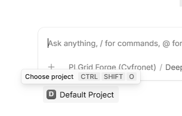
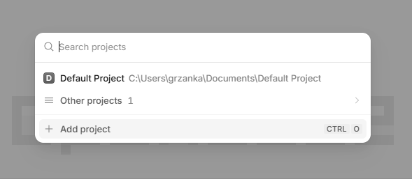
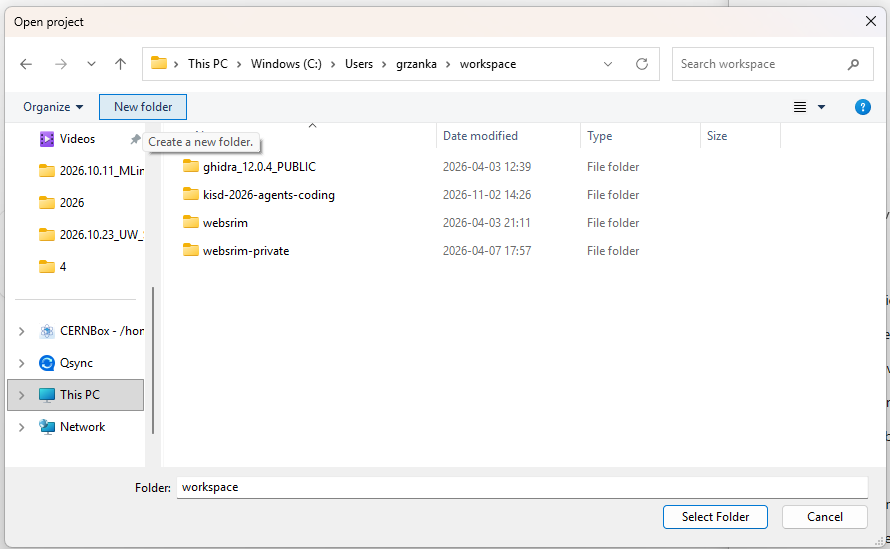
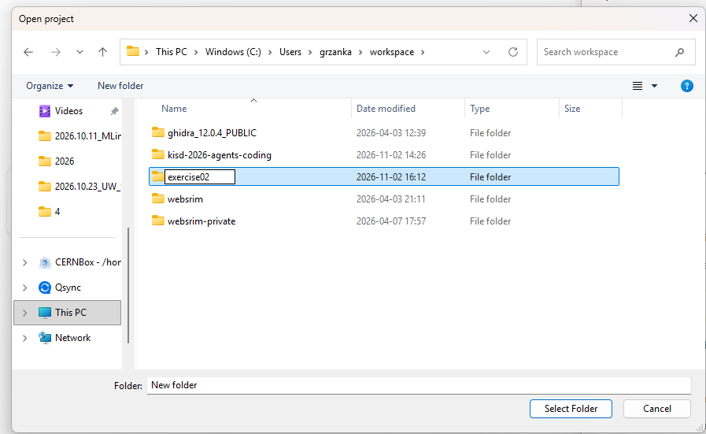
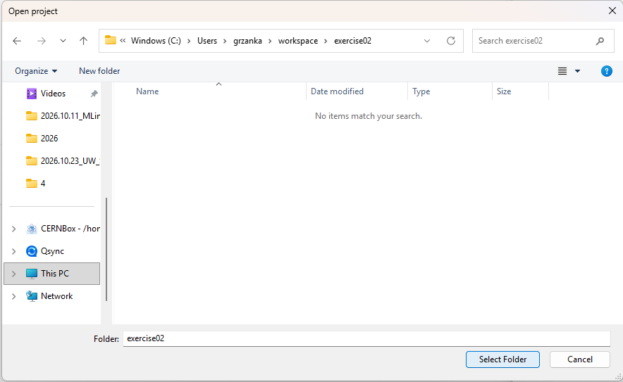
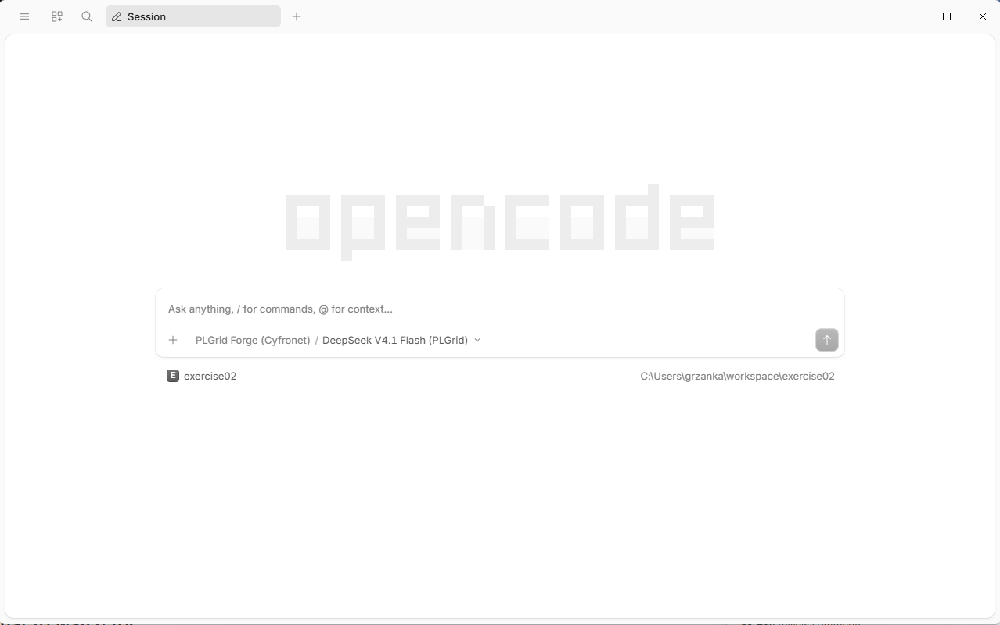

# Before each exercise: create a project folder

You may be used to working with **one file at a time**: you open a Word document,
edit it, save it. An agent works differently. It works with a **whole folder**,
called the **project**. It can read, create and change every file in that folder,
and nothing outside it. Over an exercise the agent fills the folder with several
files: the data, a script, a plot and a report.

So the rule is: **one project = one folder**. Each exercise gets its own new,
empty folder. That keeps the files of different exercises apart, and keeps the
agent away from your other files.

You create the folder from inside opencode. Here the folder for
[Exercise 1](02-pendulum.md) is called `kisd-pendulum`. Later exercises tell you
the name of their folder; repeat these steps with that name.

## Step 1. Choose a project

Start the opencode app (press the **Windows** key, type `opencode`, press
**Enter**). Under the text box you see the current project, after installing it
is **Default Project**. Click it, or press **Ctrl+Shift+O**.



## Step 2. Add a project

A list of projects opens. Click **Add project** (or press **Ctrl+O**).



## Step 3. Create a new folder

A window **Open project** opens. It looks like File Explorer. Go to the place
where you want to keep your exercises, for example **Documents**: click
**This PC** on the left, then **Documents**. Then click **New folder** at the top.



## Step 4. Name the folder

A new folder appears, with its name ready to type over. Type `kisd-pendulum` and
press **Enter**. (In the picture the folder is called `exercise02`; use
`kisd-pendulum`.)



## Step 5. Open the folder and select it

Double-click the new folder to go into it. It is empty, so the window says
*No items match your search*. That is fine. Click **Select Folder**.



Expected result: opencode shows the new project under the text box, with its
full path on the right, and the model **PLGrid Forge (Cyfronet) / DeepSeek V4.1
Flash (PLGrid)** in the text box.



If you see a different model, click its name and choose **DeepSeek V4.1 Flash
(PLGrid)**.

<details>
<summary>Errors</summary>

- You clicked **Select Folder** before going into the new folder: opencode
  opened the folder above it, for example **Documents**. Repeat from step 1 and
  double-click `kisd-pendulum` before you click **Select Folder**.
- The new folder is called *New folder*: you clicked somewhere else before
  typing the name. Right-click it, choose **Rename**, type `kisd-pendulum`, and
  press **Enter**.

</details>

<details>
<summary>Going further: create the folder in the terminal</summary>

In PowerShell (or a Linux/macOS terminal), this creates the folder in your user
folder:

```powershell
mkdir kisd-pendulum
```

Then open it in opencode with **Add project** as in step 2, and skip steps 3
and 4.

</details>

## Next time

The folder stays in the project list. To come back to it later, click the
project name under the text box and choose `kisd-pendulum` from the list.

---

← Previous: [Before the exercises: Python](00-prerequisites.md) · [Overview](README.md) · Next: [Exercise 1 →](02-pendulum.md)
