# Exercise 1: Your first agent session — measuring *g* with a pendulum

In a chat (ChatGPT, Copilot chat, the llmlab web page) you ask, the model
answers, and **you** copy the code, run it, and paste the errors back. An agent
does that loop **itself**: it writes files, runs them, reads the output, and
fixes what went wrong.

In this exercise you watch that happen on a small physics task. A student lab
measured how long pendulums of different lengths take to swing. From that you
compute the gravitational acceleration *g* (about 9.81 m/s²). The data has two
traps in it, as real lab data often does. You will see how the agent deals with
them.

You do **not** need to write or read any Python. You only type prompts and
watch.

- Time: about 30–40 minutes.
- You need: the opencode app connected to llmlab (pages 2–4 of
  [Getting started](../01-getting-started/README.md)), Python installed
  ([Before the exercises](00-prerequisites.md)), and an empty project folder
  ([Create a project folder](01-project-folder.md)).

<details>
<summary>Explain: agent, tool, tool call, agentic loop</summary>

- **Model**: the program that reads text and writes text. On its own it cannot
  see your computer.
- **Tool**: an action the agent offers the model: read a file, write a file, edit
  a file, run a command in the terminal.
- **Tool call**: the model asks for one of those actions, for example "run
  `python analyse.py`". The agent carries it out and sends the result back to the
  model.
- **Agentic loop**: the model thinks, calls a tool, looks at the result, and
  decides what to do next. It repeats this until the task is done, then answers
  you.

</details>

## What to watch for

Above each answer, opencode shows a summary line such as *Used 2 Read, Shell*.
Click it (the small ▾) to open the details: each tool call on its own line, with
the tool name and its target. The tools you will see:

- **Read** (also *List* or *Glob*): the agent looks at files or folders.
- **Write**: the agent creates a new file, or writes a whole file again.
  opencode shows its content with the new lines in green.
- **Edit**: the agent changes part of an existing file. opencode shows the change
  in red (removed) and green (added).
- **Shell**: the agent runs a command in the terminal and reads its output.

You will also see **Thought**: the model thinking before it acts. It is not a
tool call; nothing happens on your computer. Open the Thoughts: they show why
the agent did what it did.

<details>
<summary>Picture: the conversation with all details closed</summary>

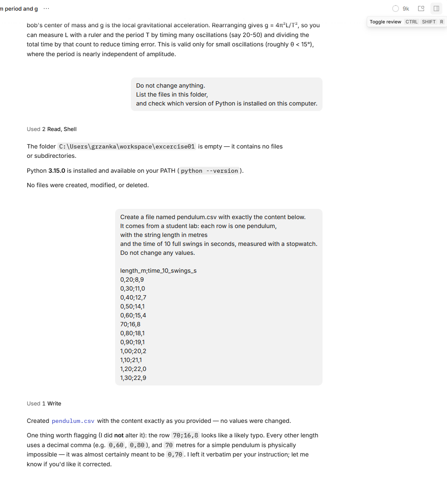

</details>

After each step below, count which tools you saw. That is the whole point of the
exercise.

The pictures on this page come from one test run. Your run will differ: the
model words its answers differently each time, may pick other tools, and may
write a longer or shorter script. The numbers should be the same.

If opencode asks for **permission** before a tool call, read what it wants to do,
then approve it.

## Before you start: open the project

Create the folder `kisd-pendulum` and open it as the project in opencode, as in
[Before each exercise: create a project folder](01-project-folder.md).

Expected result: under the text box you see the project `kisd-pendulum`, and the
model **PLGrid Forge (Cyfronet) / DeepSeek V4.1 Flash (PLGrid)**.

## Step 1: A plain question (chat mode)

Paste this into the opencode text box and press **Enter**:

```text
What is the formula for the period of a simple pendulum,
and how can I use it to measure g?
Answer in three sentences.
```

Expected result: *Used 1 Thought*, then a short answer with T = 2π√(L/g), so
g = 4π²L/T².

<details>
<summary>Picture: the answer in the test run</summary>


</details>

**What to notice:** no tool calls, only a Thought. The model answered from what
it knows, exactly like a chat. In the test run it even added a condition you did
not ask for: the formula holds only for small swings. Everything from here on is
different.

## Step 2: Look around (read-only tools)

```text
Do not change anything.
List the files in this folder,
and check which version of Python is installed on this computer.
```

Expected result: *Used 2 Read, Shell*, then the answer: the folder is empty,
and the Python version, such as `Python 3.15.0`. Open the line to see the
details: **Read** of your project folder, and **Shell** with the command
`python --version` and its output.

<details>
<summary>Picture: Read and Shell in the test run</summary>

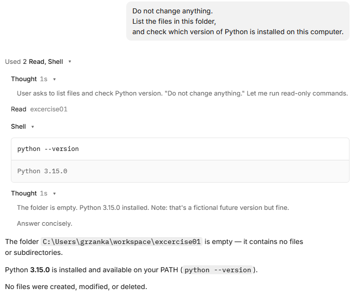

</details>

**What to notice:** the model cannot see your disk. To answer, it had to call
**Read** to list the files and **Shell** to run `python --version`, then read
the results. You did not tell it which commands to use. Some runs use **Glob**
instead of Read, or check for hidden files too; the result is the same.

Look at the last Thought: the model calls Python 3.15.0 a *fictional future
version*. The model was trained before that version came out, so it does not
know it. It trusted the output of the command over its own memory, which is
right.

<details>
<summary>If Python is not installed</summary>

On Windows the agent may report *"Python was not found; run without arguments to
install from the Microsoft Store"*. Close the opencode window and follow
[Before the exercises: check that Python is installed](00-prerequisites.md).
Then start the opencode app again. If the project under the text box is not
`kisd-pendulum`, click it and choose `kisd-pendulum` from the list. Repeat this
step.

</details>

## Step 3: Create the data file (`Write`)

The data below was typed into Polish Excel and exported as CSV, so it uses
semicolons and decimal commas. Paste the whole prompt, including the data:

```text
Create a file named pendulum.csv with exactly the content below.
It comes from a student lab: each row is one pendulum,
with the string length in metres
and the time of 10 full swings in seconds, measured with a stopwatch.
Do not change any values.

length_m;time_10_swings_s
0,20;8,9
0,30;11,0
0,40;12,7
0,50;14,1
0,60;15,4
70;16,8
0,80;18,1
0,90;19,1
1,00;20,2
1,10;21,1
1,20;22,0
1,30;22,9
```

opencode may show the pasted text as a single block, such as
`[Pasted ~14 lines]`. That is fine.

Expected result: *Used 1 Write*. Open it: you see the content of
`pendulum.csv`, 13 lines in green (*+13 -0*: 13 lines added, none removed).

<details>
<summary>Pictures: the Write in the test run</summary>

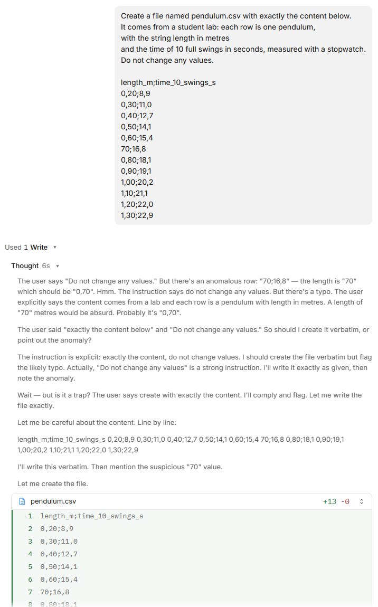

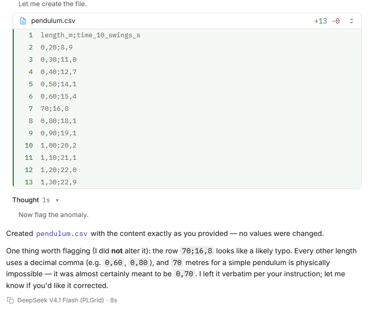

</details>

**What to notice:** the agent created a real file on your disk. In a chat you
would have to copy the text and save the file yourself.

The agent probably already points at the row `70;16,8`. In its Thought it even
asks itself *"is it a trap?"* Because you said *do not change any values*, it
copied the row as it is and only told you. That is the right behaviour: you
decide what to do with raw data. Keep the row; it matters in step 5.

### Look at the file in opencode

opencode can show you the files of the project, next to the conversation.

1. At the top right of the window, click the **Toggle review** button (the
   square with a bar on the right), or press **Ctrl+Shift+R**.

   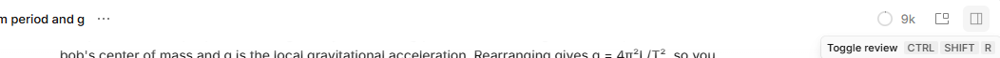

2. A panel opens on the right with a **New tab**. Click **Open file** (or press
   **Ctrl+Alt+P**).

   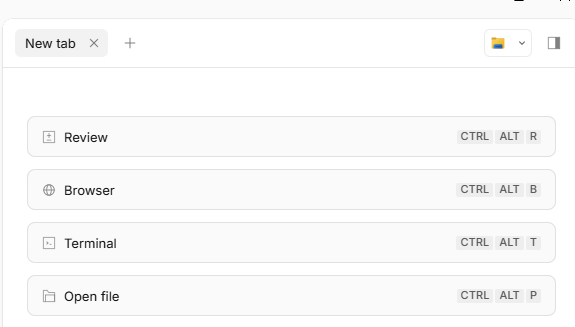

3. You see the files of your project. Click `pendulum.csv`.

   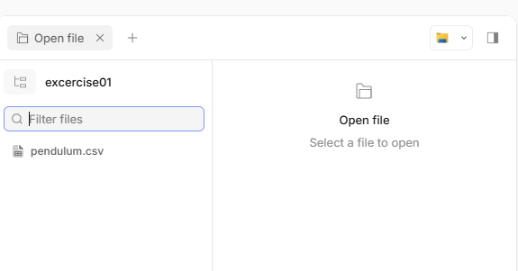

Expected result: the file is shown as a table, but the columns look wrong:
`0` in one column, `20;8` in the next, `9` in the third.

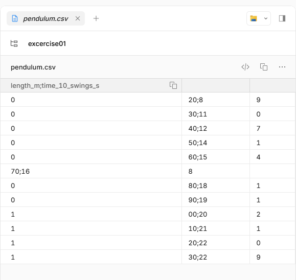

The file is fine; the viewer is not. It expects commas between the columns, as
in English CSV files, so it splits the Polish decimal commas instead of the
semicolons. Your own analysis must not make the same mistake. Watch whether the
agent's script does in step 4.

You can also open the file in File Explorer: go to your `kisd-pendulum` folder
and open `pendulum.csv` in Notepad.

## Step 4: Analyse (`Write` + `Shell` + the loop)

```text
Write a short Python script named analyse.py that reads pendulum.csv.
For each row, compute the period T (time of 10 swings divided by 10)
and g = 4 * pi^2 * length / T^2.
Print a table with one row per pendulum, then the mean of g.
Use only the Python standard library.
Run the script and show me the output.
```

Expected result: *Used 2 Write, Shell*: the new script `analyse.py` in green,
then **Shell** `python analyse.py`. Below it, the output: a table of 12 rows,
then a mean *g* of about **90.58 m/s²**. That is far too large. Keep it for the
next step.

<details>
<summary>Pictures: the script and its output in the test run</summary>

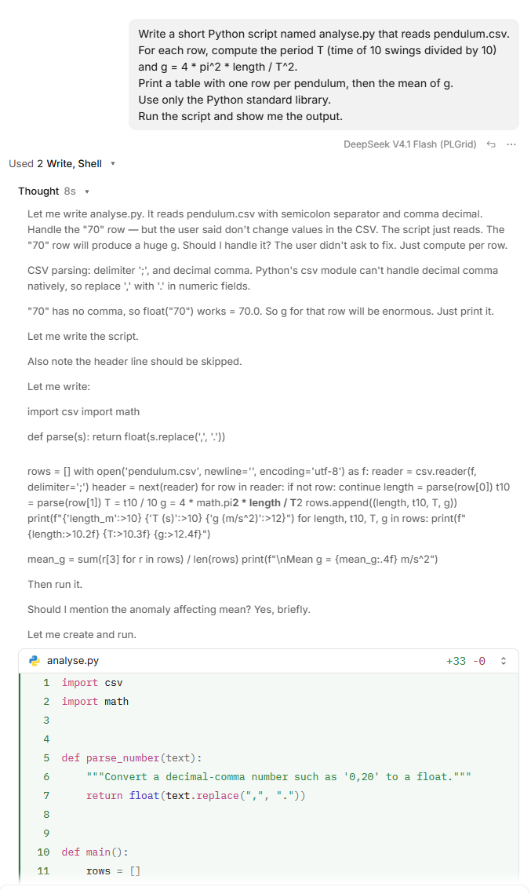


</details>

**What to notice:** several tool calls in a row: **Write** for the script, then
**Shell** to run `python analyse.py`. The agent read the output before answering
you. Its Thought shows that it saw the decimal commas in advance.

Sometimes the first run fails, because Python does not read `0,20` as a number.
You then see an error such as
`ValueError: could not convert string to float: '0,20'`, followed by an **Edit**
of the script and a second run, without you doing anything. That is the agentic
loop: act, look at the result, fix, try again. In our test runs the first run
always worked. Ask your neighbour whether theirs failed.

**Check the agent's words, not only its numbers.** In the test run the agent
wrote that without the row `70` *"the mean would be about 9.78 m/s²"*. The
correct value is **9.80**: you can see it yourself, all the other rows are
between 9.64 and 9.99. The agent did not run any code for that sentence; it
estimated it, and wrote the estimate as confidently as the real results. In the
same answer it also suggested correcting the CSV file. Do not do that yet.

## Step 5: Find the problem (reasoning on results)

```text
The mean g is far from 9.81 m/s^2.
Look at the per-row results and find out why.
Do not change any files yet, just explain.
```

Expected result: *Used 1 Thought*, then an explanation. The agent points to the
row with length `70`: its *g* is about **979**, a hundred times too large, and
this one row pulls the mean up from about 9.8 to 90.6.

<details>
<summary>Picture: the explanation in the test run</summary>


</details>

**What to notice:**

- The agent used the output of its own script as evidence. Here it did not need
  any tool; it reasoned on what it already had.
- In the Thought it added up the other eleven values by hand and got 9.80. So
  it quietly corrected its own *9.78* from step 4, without telling you.
- The best evidence is in the second column. The time, 16.8 s for 10 swings,
  gives T = 1.68 s, which is just what a **0.70 m** pendulum swings
  (g = 4π²·0.70/1.68² ≈ 9.79). So the length is wrong, not the time.
- The agent also says *why* the length is 70: in our test runs it always guessed
  a typo, a lost `0,`. A length in centimetres gives the same 0.70 m. The data
  cannot tell which; it is a guess, even if the agent sounds sure.

<details>
<summary>Explain: could it really be a 70 m pendulum?</summary>

A 70 m pendulum has a period of 16.8 s. That is exactly the number in the second
column. So the row could also mean "70 m, timed for **one** swing instead of
10". Only the setting rules this out: a student lab has no 70 m pendulum. The
numbers alone fit both stories. Context is your job, not the agent's.

</details>

## Step 6: Fix it (`Edit` or `Write`)

The agent found **which** value is wrong. It cannot know **why**: a lost `0,`
and a length in centimetres both give 0.70 m. That needs knowledge from outside
the data. Suppose you checked the student's lab notebook: they measured that
pendulum as 70 **cm** and typed the number without converting it. You give the
agent this fact, and you decide how to fix it:

```text
I checked the lab notebook.
That length of 70 is not a typo for 0,70:
the student measured 70 cm and forgot to convert it to metres.
Fix it in analyse.py, not in pendulum.csv:
convert any length above 10 to metres and print a warning when you do.
Also print the standard error of the mean of g.
Run the script again.
```

Expected result: a change of `analyse.py`, then **Shell** runs it again. The
output starts with a warning about the length 70, the row now shows `0.70` with
g = 9.79, and at the end a mean *g* of about **9.80 m/s²** with a standard error
of about **0.03 m/s²**.

<details>
<summary>Pictures: the fix in the test run</summary>

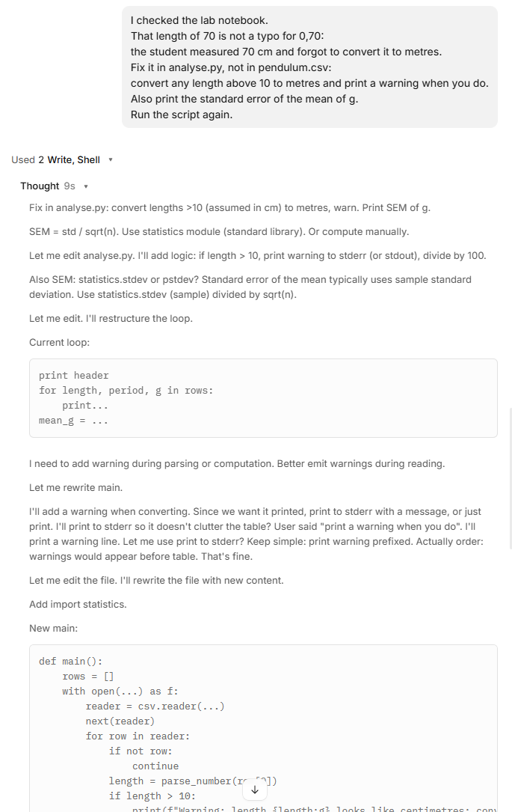

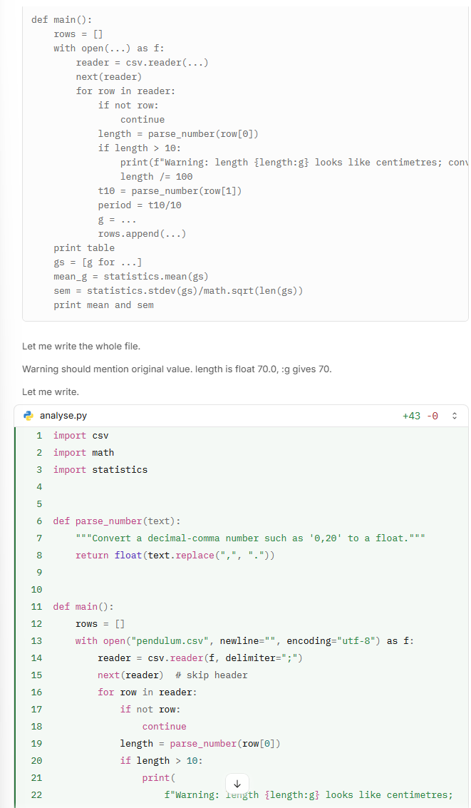

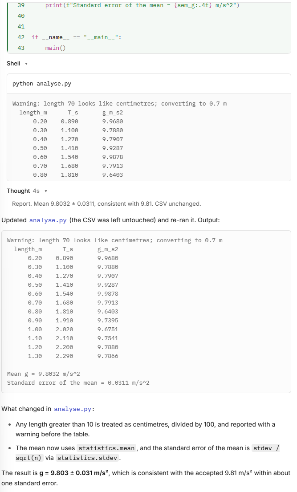

</details>

**What to notice:** to change a file, the agent can **Edit** part of it (red and
green lines) or **Write** the whole file again (all green). In the test run it
chose to write the whole file again (*Used 2 Write, Shell*, *+43 -0*). Both
work, but with a full rewrite you cannot see at a glance what changed. The agent
then listed its changes in the answer; read that list. It also checked its work
by running the script again.

The final sentence of the test run says the result *"is consistent with the
accepted 9.81 m/s² within about one standard error"*. Check it: 9.81 − 9.803 =
0.007, and one standard error is 0.031. So it is true, with room to spare.

<details>
<summary>Explain: why fix the script and not the data?</summary>

`pendulum.csv` is the raw data. If you correct it by hand, nobody can later see
that a correction was made. The correction in the script is written down, prints
a warning, and runs the same way every time. This is good practice in any data
analysis, with or without an agent.

</details>

## Step 7: A separate Python for this project (`Shell` + installing a package)

For the plot the agent needs **matplotlib**, a Python package that is not part
of Python itself. You want it installed **inside this project folder**, not into
the Python of your whole computer. Python calls such a private copy a **virtual
environment** (venv for short).

```text
Create a Python virtual environment named .venv in this folder.
Install matplotlib into it.
From now on, in this session, run all Python code
with .venv\Scripts\python.exe, never with the system Python,
and install every package you need into .venv.
Do not activate the environment; call .venv\Scripts\python.exe directly.
```

Expected result: several **Shell** calls: `python -m venv .venv` to create the
environment, then `.venv\Scripts\python.exe -m pip install matplotlib`. The
installation takes up to a minute. opencode may ask you to allow the commands;
allow them. A new folder `.venv` appears in your project folder.

<details>
<summary>Pictures: the venv in the test run</summary>

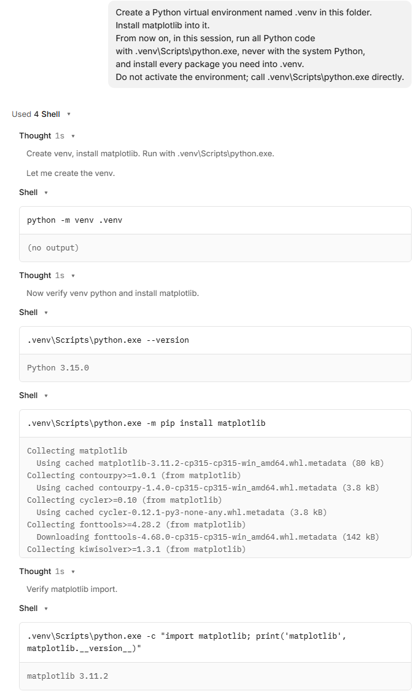

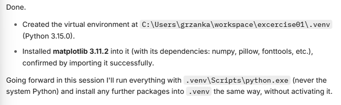

</details>

**What to notice:** the agent prepared the environment, not only the code. In
the test run it used four **Shell** calls, and two of them were checks you did
not ask for: the Python version inside the venv, and a test that matplotlib
really imports. Then it repeated your rule back to you. matplotlib brought other
packages with it, such as **numpy**; they are all inside `.venv`.

<details>
<summary>Explain: why a virtual environment?</summary>

- **Clean and separate.** Every project keeps its own packages, in its own
  versions. Installing something for one project cannot break another one.
- **Easy to remove.** Everything is in the `.venv` folder. Delete the folder and
  it is gone; your computer's Python stays as it was.
- **Repeatable.** You (or the agent) can list exactly what this project uses,
  and set it up again on another computer.
- **Why not activate it?** "Activating" a venv only changes the current
  terminal window. The agent opens a fresh one for each command, so the
  activation would be lost. On Windows, activation in PowerShell is also often
  blocked by the *running scripts is disabled on this system* rule. Calling
  `.venv\Scripts\python.exe` directly always works.
- **"From now on, in this session".** The agent remembers this only in the
  current conversation. In a new session, say it again, or write it into
  `AGENTS.md` (see [`/init`](../01-getting-started/05-first-steps.md)), which
  opencode reads at the start of every session.

On Linux and macOS the path is `.venv/bin/python` instead of
`.venv\Scripts\python.exe`; change the prompt accordingly.

</details>

## Step 8: Plot (`Edit` + `Shell` + `Read`)

```text
Add a plot to analyse.py:
the measured period T against the length as points,
and the curve T = 2*pi*sqrt(L/g) with the mean g as a line.
Label the axes with units. Save it as pendulum.png.
Do not open a plot window.
Run the script with the Python from .venv.
```

Expected result: an **Edit** of `analyse.py`, then **Shell**
`.venv\Scripts\python.exe analyse.py`. A new file `pendulum.png` appears in the
folder. The agent may then **Read** `pendulum.png`: the plot appears right in
the conversation. The 12 points lie on, or very close to, the red curve.

<details>
<summary>Pictures: the plot in the test run</summary>

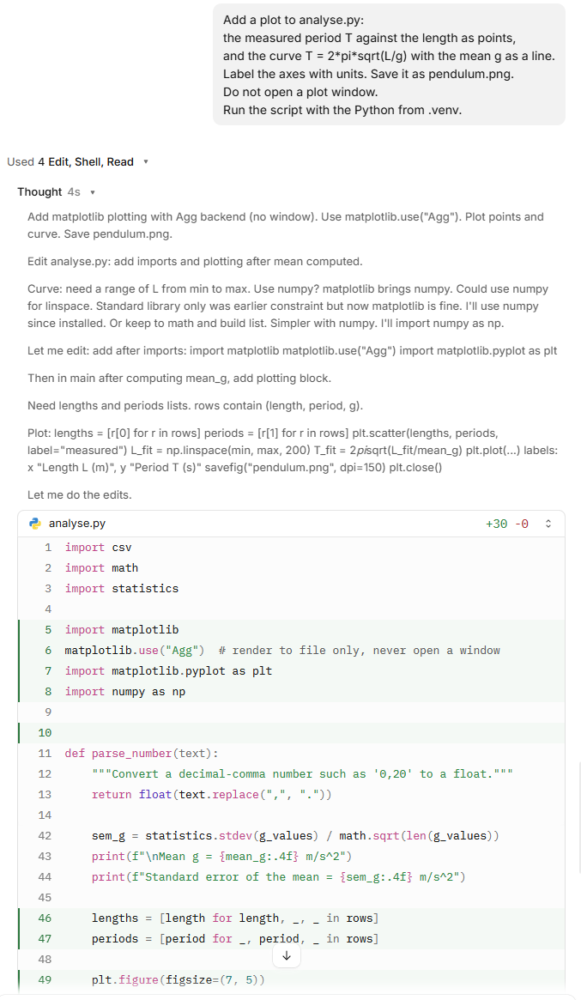

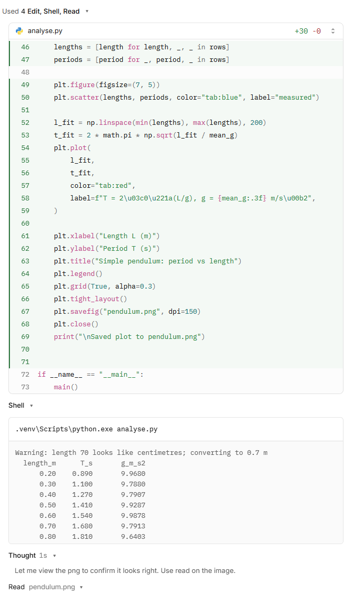

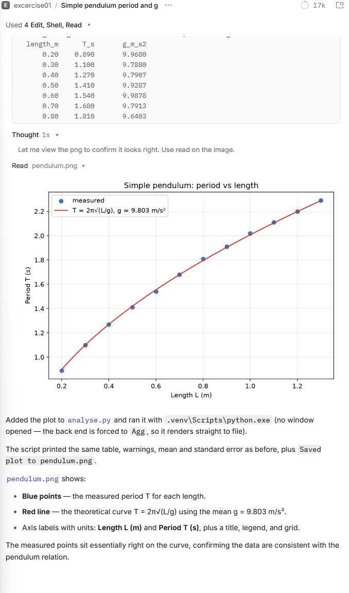

</details>

**What to notice:**

- Check the **Shell** line. It should say `.venv\Scripts\python.exe
  analyse.py`. If it says plain `python analyse.py`, the agent forgot the venv
  and the script fails with *No module named 'matplotlib'*. Remind it: "Use
  .venv\Scripts\python.exe."
- To keep the plot window closed, the agent switched matplotlib to its
  file-only mode (`matplotlib.use("Agg")`).
- After saving the plot, the agent **read the picture** to check its own work,
  without being asked. See below what that means.

<details>
<summary>Explain: what does it mean that the agent "reads" a png file?</summary>

**Read** works on pictures too. When the agent reads `pendulum.png`, opencode
does two things:

- It shows the picture to **you**, in the conversation. That is why the plot
  appeared without you opening it.
- It sends the picture to the **model** as an image, so that a model that can
  understand pictures can look at it, as a person looks at a screenshot.

Whether the model really *looked* is another matter. Some models read only
text; for them the picture is just a note that a file was read. The agent's
description in the test run (blue points, red curve, labels with units) matches
what the code was told to draw, so it could have been written without seeing
the picture at all. You cannot tell from the answer.

So: when the agent says "the plot looks right", treat it as a claim, not a
check. Look at the plot yourself. Things only your eyes may catch: a point far
off the curve, an axis in the wrong units, a curve that does not pass through
the points.

</details>

<details>
<summary>Explain: why "do not open a plot window"?</summary>

A plot window stays open until you close it, and the script waits for it. The
agent would wait too, and look frozen. Saving to a file lets the script finish.

</details>

## Step 9: Look at the plot

The plot is a file in your project. Ask the agent to show it to you:

```text
Show me pendulum.png.
```

Expected result: the plot opens in the panel on the right, and again in the
conversation. In the test run the agent used two new tools: **Skill** (it loaded
instructions for the opencode browser) and **Execute** (it ran
`browser.preview` with the file `pendulum.png`).

<details>
<summary>Picture: the plot in the side panel in the test run</summary>

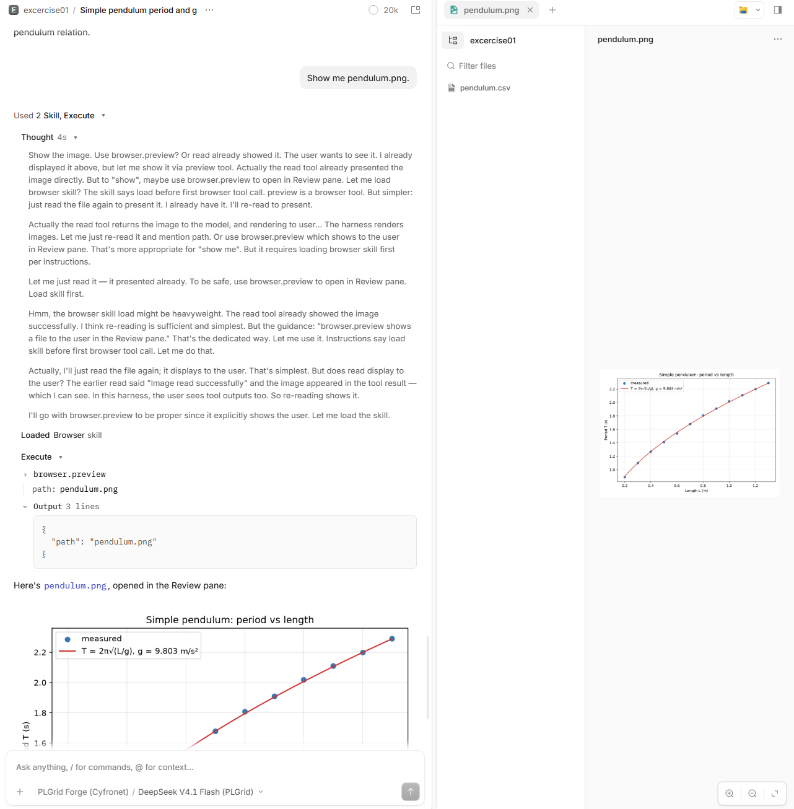

</details>

**What to notice:** open the Thought. The model spends a long paragraph going
back and forth: read the picture again, or use the browser preview? It changes
its mind several times. A simple request can cost many model calls, and so
credits. The plot was already visible after step 8; this step was not needed,
but now you know where to find it.

In the right panel, the zoom buttons at the bottom right make the plot larger.
You can also open `pendulum.png` from File Explorer, in your `kisd-pendulum`
folder.


## Step 10: Write the report (`Write` from results)

```text
Write report.md: a half-page lab report with
the aim, the method (the formula),
a note about the centimetre correction,
the result for g with its standard error,
a comparison with 9.81 m/s^2,
and the plot pendulum.png embedded.
```

Expected result: a new file `report.md`. Open it in Notepad (or, better, in VS
Code, which shows the plot). The numbers in it should match what the script
printed in step 6. **Check this yourself.**

## Step 11: Ask the agent what it did

```text
List, in order, every tool you used in this session,
and for each one say in one sentence why you needed it.
```

Expected result: a list such as read, write, run, edit, run, install… Compare it
with the tool calls you saw on screen. Do they match?

You are done. Close the opencode window, or keep it open for "Going further".

## What just happened

Every step above followed the same loop:

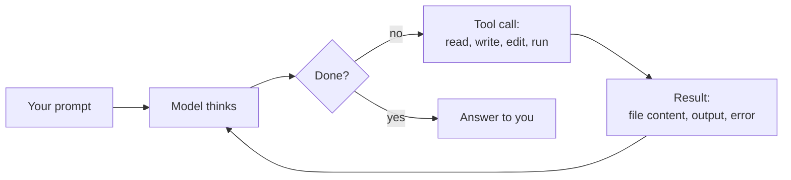

| | Chat | Agent |
|---|---|---|
| Sees your files | Only what you paste | Reads them itself |
| Runs code | No, you do | Yes, and reads the output |
| Fixes its errors | Only if you paste the error back | Yes, in the loop |
| Leaves results | Text in a chat window | Files on your disk: `analyse.py`, `pendulum.png`, `report.md`, and the `.venv` with its packages |
| Your job | Copy, paste, run | Give clear tasks, **check the results** |

The last row matters most. The agent can be confidently wrong. It found the
centimetre error here because the number was absurd. A small error, say 0,60
typed as 0,61, would pass silently. You are still the scientist.

## If something goes wrong

- **The agent only describes what it would do but does not do it.** Reply
  "Go ahead and do it."
- **"not available for grant"**: your grant cannot use the default model. See
  [Which model](../01-getting-started/05-first-steps.md#which-model).
- **`pip` fails with a network or proxy error.** Ask the agent to try again; if it
  keeps failing, skip the plot and do step 10 without it.
- **The agent stops without a result.** Check whether the expected file exists.
  If not, send the same prompt again, or add "Run the script and show me the
  output" at the end.
- **Activate.ps1 cannot be loaded because running scripts is disabled.** The
  agent tried to activate the venv. Reply "Do not activate; call
  .venv\Scripts\python.exe directly."
- **No module named 'matplotlib'.** The agent ran the system Python. Reply "Use
  .venv\Scripts\python.exe."
- **The numbers differ a little from those above.** Small differences (for example
  9.79 instead of 9.80) are fine. A different order of magnitude is not: ask the
  agent to explain.

<details>
<summary>Going further</summary>

- **Change the data yourself.** Open `pendulum.csv` in Notepad, add a row
  `1,40;23,8`, save, and ask the agent to "run the analysis again". It reads the
  current file, not what it remembers.
- **Plan first.** Ask: "Do not change any files yet. How would you estimate g
  from a straight-line fit of T^2 against L instead of the mean?" The agent only
  reads and proposes. If the plan looks good, reply "Go ahead" and let it do it.
  Does the fit give the same *g*? Why might it not?
- **Undo.** `/undo` takes back the last message and its file changes. It needs a
  Git repository: ask the agent to "initialise a git repository and commit all
  files" first.
- **Look at the code.** Open `analyse.py`. It is about 40–80 lines. Ask the
  agent to explain any line you do not understand.

</details>

---

← Previous: [Create a project folder](01-project-folder.md) · [Exercises overview](README.md) · [Main README](../README.md)
