# Exercise 1: Your first agent session — measuring *g* with a pendulum

In a chat (ChatGPT, Copilot chat, the llmlab web page) you ask, the model
answers, and **you** copy the code, run it, and paste the errors back. An agent
does that loop **itself**: it writes files, runs them, reads the output, and
fixes what went wrong.

In this exercise you watch that happen on a small physics task. A student lab
measured how long pendulums of different lengths take to swing. From that you
compute the gravitational acceleration *g* (about 9.81 m/s²). The data has two
traps in it, as real lab data often does. You will see how the agent deals with
them.

You do **not** need to write or read any Python. You only type prompts and
watch.

- Time: about 30–40 minutes.
- You need: the opencode app connected to llmlab (pages 2–4 of
  [Getting started](../01-getting-started/README.md)), Python installed
  ([Before the exercises](00-prerequisites.md)), and an empty project folder
  ([Create a project folder](01-project-folder.md)).

<details>
<summary>Explain: agent, tool, tool call, agentic loop</summary>

- **Model**: the program that reads text and writes text. On its own it cannot
  see your computer.
- **Tool**: an action the agent offers the model: read a file, write a file, edit
  a file, run a command in the terminal.
- **Tool call**: the model asks for one of those actions, for example "run
  `python analyse.py`". The agent carries it out and sends the result back to the
  model.
- **Agentic loop**: the model thinks, calls a tool, looks at the result, and
  decides what to do next. It repeats this until the task is done, then answers
  you.

</details>

## What to watch for

Above each answer, opencode shows a summary line such as *Used 2 Read, Shell*.
Click it (the small ▾) to open the details: each tool call on its own line, with
the tool name and its target. The tools you will see:

- **Read** (also *List* or *Glob*): the agent looks at files or folders.
- **Write**: the agent creates a new file. opencode shows its content with the
  new lines in green.
- **Edit**: the agent changes part of an existing file. opencode shows the change
  in red (removed) and green (added).
- **Shell**: the agent runs a command in the terminal and reads its output.

You will also see **Thought**: the model thinking before it acts. It is not a
tool call; nothing happens on your computer.

After each step below, count which tools you saw. That is the whole point of the
exercise.

If opencode asks for **permission** before a tool call, read what it wants to do,
then approve it.

## Before you start: open the project

Create the folder `kisd-pendulum` and open it as the project in opencode, as in
[Before each exercise: create a project folder](01-project-folder.md).

Expected result: under the text box you see the project `kisd-pendulum`, and the
model **PLGrid Forge (Cyfronet) / DeepSeek V4.1 Flash (PLGrid)**.

## Step 1: A plain question (chat mode)

Paste this into the opencode text box and press **Enter**:

```text
What is the formula for the period of a simple pendulum,
and how can I use it to measure g?
Answer in three sentences.
```

Expected result: a short answer with T = 2π√(L/g), so g = 4π²L/T². Above it,
opencode shows *Used 1 Thought*.

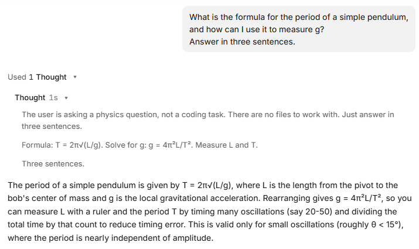

<details>
<summary>Another run: a slightly different answer</summary>

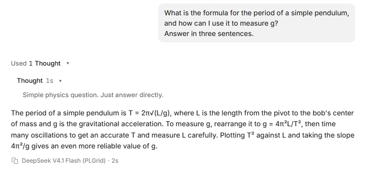

The same question gave a different wording, and this time the model added a
tip: plot T² against L and take the slope. Models do not answer the same way
twice.

</details>

**What to notice:** no tool calls, only a Thought. The model answered from what
it knows, exactly like a chat. Everything from here on is different.

## Step 2: Look around (read-only tools)

```text
Do not change anything.
List the files in this folder,
and check which version of Python is installed on this computer.
```

Expected result: *Used 2 Read, Shell*, then the answer: the folder is empty,
and the Python version, such as `Python 3.15.0`. Click the line to see the
details: **Read** of your project folder and **Shell** `python --version`.


<details>
<summary>Another run: Glob, and a check for hidden files</summary>

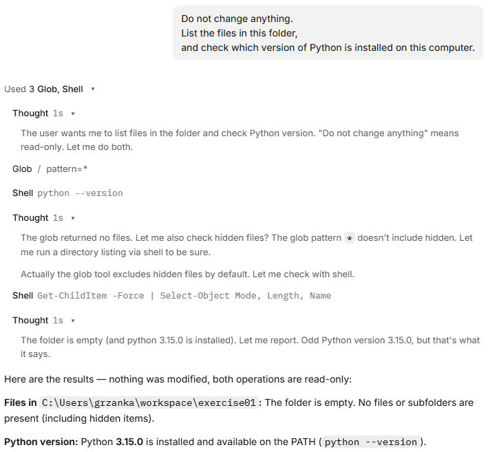

Here the agent used **Glob** to list the files, then thought that Glob skips
hidden files and checked again with **Shell** `Get-ChildItem -Force`. Different
tools, same result. Also look at its last Thought: it finds Python 3.15.0
"odd", because the model was trained before that version came out.

</details>

**What to notice:** the model cannot see your disk. To answer, it had to call
**Read** to list the files and **Shell** to run `python --version`, then read
the results. You did not tell it which commands to use. The Thoughts show its
plan: both tasks only read, so it ran them at the same time.

<details>
<summary>If Python is not installed</summary>

On Windows the agent may report *"Python was not found; run without arguments to
install from the Microsoft Store"*. Close the opencode window and follow
[Before the exercises: check that Python is installed](00-prerequisites.md).
Then start the opencode app again. If the project under the text box is not
`kisd-pendulum`, click it and choose `kisd-pendulum` from the list. Repeat this
step.

</details>

## Step 3: Create the data file (`Write`)

The data below was typed into Polish Excel and exported as CSV, so it uses
semicolons and decimal commas. Paste the whole prompt, including the data:

```text
Create a file named pendulum.csv with exactly the content below.
It comes from a student lab: each row is one pendulum,
with the string length in metres
and the time of 10 full swings in seconds, measured with a stopwatch.
Do not change any values.

length_m;time_10_swings_s
0,20;8,9
0,30;11,0
0,40;12,7
0,50;14,1
0,60;15,4
70;16,8
0,80;18,1
0,90;19,1
1,00;20,2
1,10;21,1
1,20;22,0
1,30;22,9
```

opencode may show the pasted text as a single block, such as
`[Pasted ~14 lines]`. That is fine.

Expected result: *Used 1 Write*. Open it: you see the content of
`pendulum.csv`, 13 lines in green (*+13 -0*: 13 lines added, none removed).

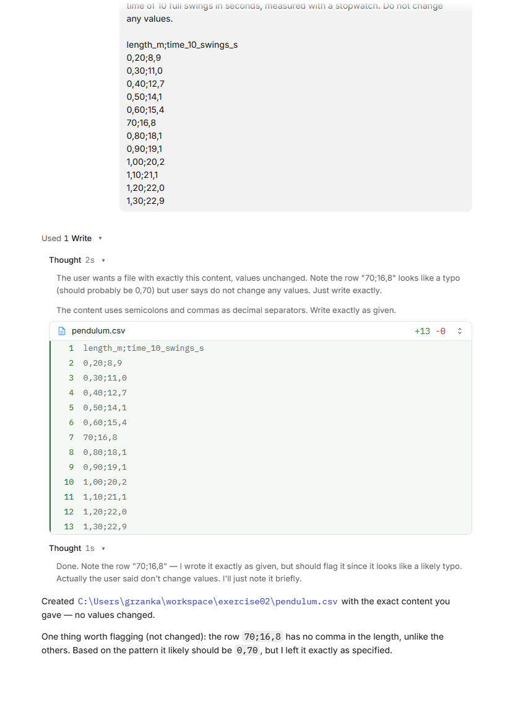

<details>
<summary>Another run: Write, then Read to check</summary>

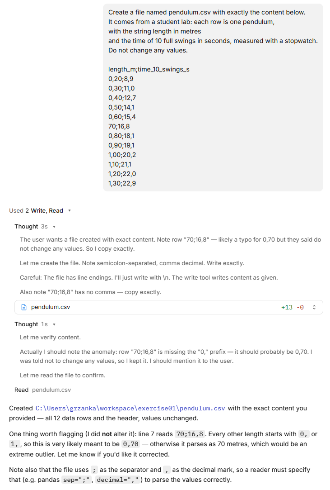

This time the agent read the file back after writing it, to check its own
work, without being asked.

</details>

Open File Explorer and go to your `kisd-pendulum` folder: the file is there. You
can open it in Notepad.

**What to notice:** the agent created a real file on your disk. In a chat you
would have to copy the text and save the file yourself.

The agent may already point at the row `70;16,8`, which looks different from the
others. Because you said *do not change any values*, it left the row as it is
and only told you. That is the right behaviour: you decide what to do with raw
data. Keep the row; it matters in step 5.

## Step 4: Analyse (`Write` + `Shell` + the loop)

```text
Write a short Python script named analyse.py that reads pendulum.csv.
For each row, compute the period T (time of 10 swings divided by 10)
and g = 4 * pi^2 * length / T^2.
Print a table with one row per pendulum, then the mean of g.
Use only the Python standard library.
Run the script and show me the output.
```

Expected result: *Used 2 Write, Shell*. Open it: the new script `analyse.py`
in green, then **Shell** `python analyse.py`.

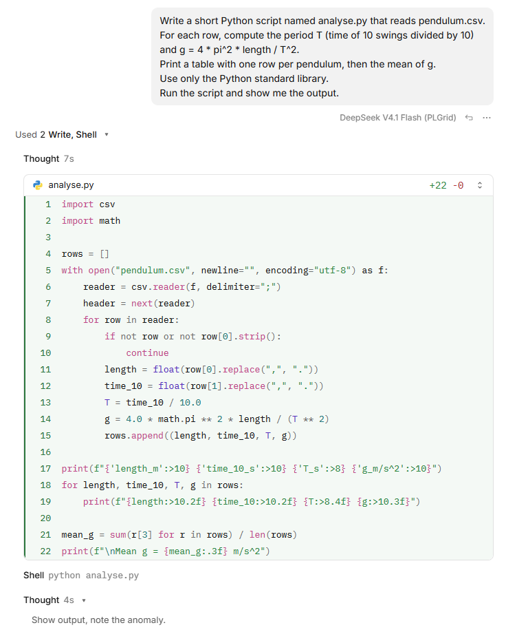

Below it, the output: a table of 12 rows, then a mean *g* of about
**90 m/s²**. That is far too large. Keep it for the next step.

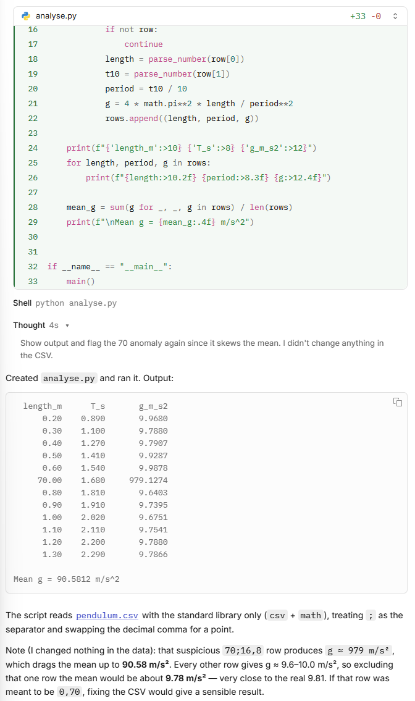

<details>
<summary>Another run: a longer script, the same numbers</summary>

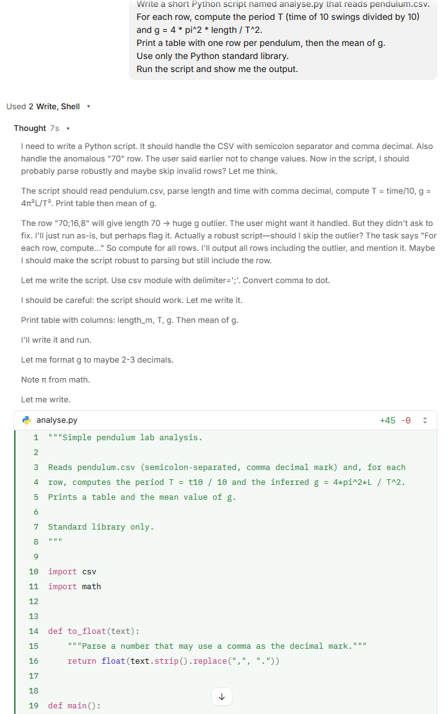

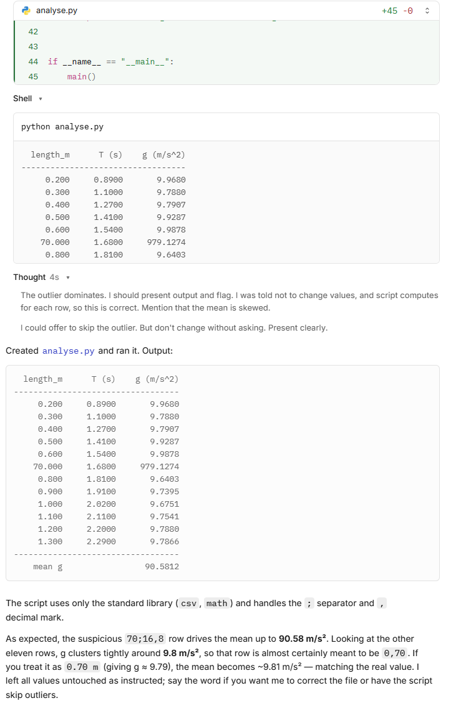

A different script (45 lines instead of 22), the same numbers. Check the last
paragraph: the agent says that with 0.70 m "the mean becomes ~9.81 m/s²". The
real value is 9.80. Close, but it rounded towards the answer it expected.

</details>

**What to notice:** several tool calls in a row: **Write** for the script, then
**Shell** to run `python analyse.py`. The agent read the output before answering
you. It may also point at the row `70` again, as in the picture.

Sometimes the first run fails, because Python does not read `0,20` as a number.
You then see an error such as
`ValueError: could not convert string to float: '0,20'`, followed by an **Edit**
of the script and a second run, without you doing anything. That is the agentic
loop: act, look at the result, fix, try again. In the run in the pictures the
agent saw the decimal commas in advance and the first run worked. Ask your
neighbour whether theirs failed.

## Step 5: Find the problem (reasoning on results)

```text
The mean g is far from 9.81 m/s^2.
Look at the per-row results and find out why.
Do not change any files yet, just explain.
```

Expected result: *Used 1 Thought*, then an explanation. The agent points to the
row with length `70`: its *g* is about **979**, a hundred times too large, and
this one row pulls the mean up from about 9.8 to 90.6.

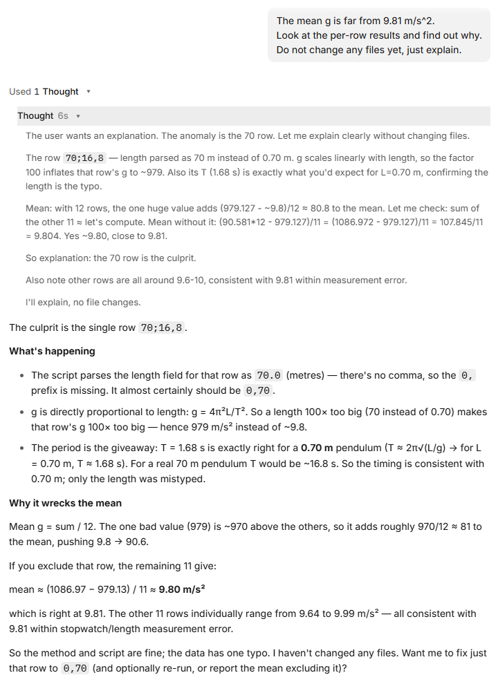

<details>
<summary>Another run: a different argument for the same row</summary>

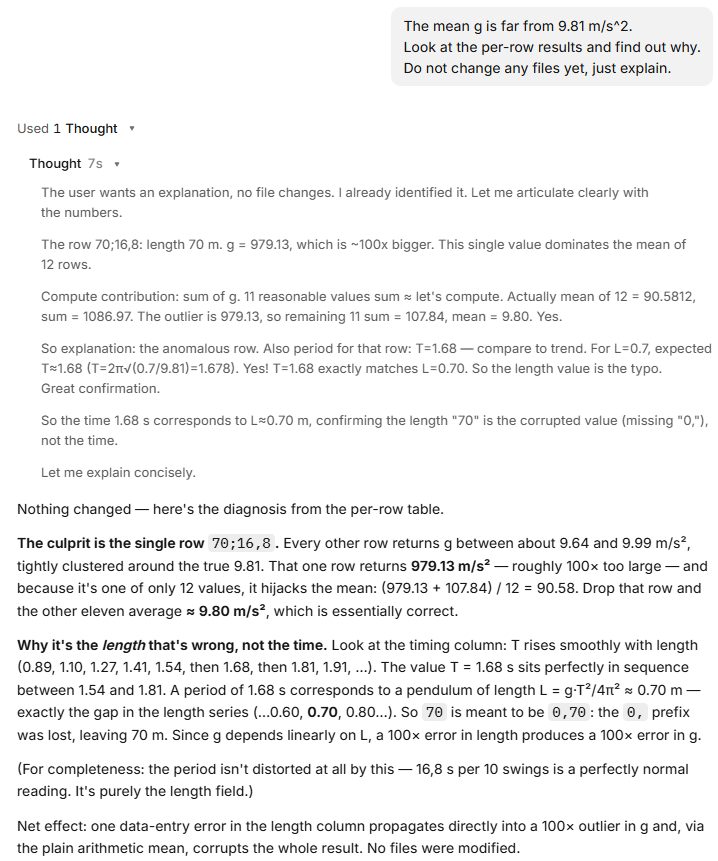

This time the agent argued from the order of the periods: 1.68 s sits
between 1.54 s and 1.81 s, just where a 0.70 m pendulum belongs. Again it
guessed a lost `0,`, not centimetres.

</details>

**What to notice:**

- The agent used the output of its own script as evidence. Here it did not need
  any tool; it reasoned on what it already had.
- The best argument is in the second column. The time, 16.8 s for 10 swings,
  gives T = 1.68 s, which is just what a **0.70 m** pendulum swings. So the
  length is wrong, not the time.
- The agent says *why* the length is 70: you may read "the length was written in
  centimetres" or "a typo, `0,` is missing". Both give 0.70 m. The data cannot
  tell which; it is a guess, even if the agent sounds sure.
- The agent may offer to change the row in `pendulum.csv` to `0,70`. Do not
  accept: step 6 explains why.

<details>
<summary>Explain: could it really be a 70 m pendulum?</summary>

A 70 m pendulum has a period of 16.8 s. That is exactly the number in the second
column. So the row could also mean "70 m, timed for **one** swing instead of
10". Only the setting rules this out: a student lab has no 70 m pendulum. The
numbers alone fit both stories. Context is your job, not the agent's.

</details>

## Step 6: Fix it (`Edit`)

Suppose you asked the student, and they wrote that length in centimetres. You
give the agent this fact and decide how to fix it:

```text
That length was written in centimetres.
Fix it in analyse.py, not in pendulum.csv:
convert any length above 10 to metres and print a warning when you do.
Also print the standard error of the mean of g.
Run the script again.
```

Expected result: *Used ... Edit, Shell*. Open it: an **Edit** of `analyse.py`
that shows only the changed part, with the new lines in green: the conversion
with its warning, and the standard error. Then **Shell** runs the script again.

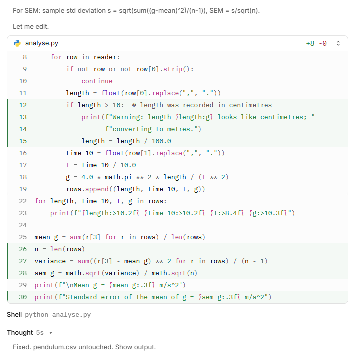 10 with a warning and division by 100, and for the standard error; then Shell python analyse.py" width="700">

The output: a warning about the row with `70`, the row now as `0.70` with
g = 9.791, a mean *g* of about **9.80 m/s²** and a standard error of about
**0.03 m/s²**.

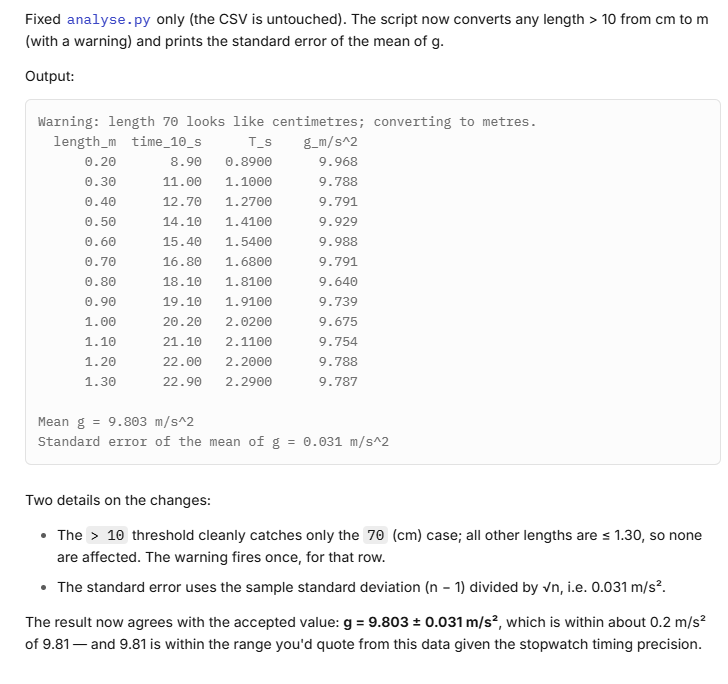

**What to notice:** the agent changed **part** of an existing file instead of
rewriting it, and checked its change by running the script again.

**Check the agent's words, not only its numbers.** In the run in the picture
the numbers are right, but the last sentence says the result is "within about
0.2 m/s² of 9.81". The real difference is 9.81 − 9.803 = **0.007 m/s²**, about
0.2 *standard errors*. The agent mixed up the units. The mistake is small here,
but it is written just as confidently as the correct parts. Read what the agent
writes the way you would read a student's report.

<details>
<summary>Explain: why fix the script and not the data?</summary>

`pendulum.csv` is the raw data. If you correct it by hand, nobody can later see
that a correction was made. The correction in the script is written down, prints
a warning, and runs the same way every time. This is good practice in any data
analysis, with or without an agent.

</details>

## Step 7: A separate Python for this project (`Shell` + installing a package)

For the plot the agent needs **matplotlib**, a Python package that is not part
of Python itself. You want it installed **inside this project folder**, not into
the Python of your whole computer. Python calls such a private copy a **virtual
environment** (venv for short).

```text
Create a Python virtual environment named .venv in this folder.
Install matplotlib into it.
From now on, in this session, run all Python code
with .venv\Scripts\python.exe, never with the system Python,
and install every package you need into .venv.
Do not activate the environment; call .venv\Scripts\python.exe directly.
```

Expected result: several **Shell** calls, such as
`python -m venv .venv`, then `.venv\Scripts\python.exe -m pip install matplotlib`.
The installation takes up to a minute. opencode may ask you to allow the
commands; allow them. A new folder `.venv` appears in your project folder.

<!-- TODO: screenshot of the venv creation and the pip install. -->

**What to notice:** the agent prepared the environment, not only the code. Ask
it to show the matplotlib version: it should run `.venv\Scripts\python.exe`,
not `python`.

<details>
<summary>Explain: why a virtual environment?</summary>

- **Clean and separate.** Every project keeps its own packages, in its own
  versions. Installing something for one project cannot break another one.
- **Easy to remove.** Everything is in the `.venv` folder. Delete the folder and
  it is gone; your computer's Python stays as it was.
- **Repeatable.** You (or the agent) can list exactly what this project uses,
  and set it up again on another computer.
- **Why not activate it?** "Activating" a venv only changes the current
  terminal window. The agent opens a fresh one for each command, so the
  activation would be lost. On Windows, activation in PowerShell is also often
  blocked by the *running scripts is disabled on this system* rule. Calling
  `.venv\Scripts\python.exe` directly always works.
- **"From now on, in this session".** The agent remembers this only in the
  current conversation. In a new session, say it again, or write it into
  `AGENTS.md` (see [`/init`](../01-getting-started/05-first-steps.md)), which
  opencode reads at the start of every session.

On Linux and macOS the path is `.venv/bin/python` instead of
`.venv\Scripts\python.exe`; change the prompt accordingly.

</details>

## Step 8: Plot (`Edit` + `Shell`)

```text
Add a plot to analyse.py:
the measured period T against the length as points,
and the curve T = 2*pi*sqrt(L/g) with the mean g as a line.
Label the axes with units. Save it as pendulum.png.
Do not open a plot window.
Run the script with the Python from .venv.
```

Expected result: an **Edit** of `analyse.py`, then **Shell**
`.venv\Scripts\python.exe analyse.py`. A new file `pendulum.png` appears in the
folder.

<!-- TODO: screenshot of the Edit and the run. -->

**What to notice:** check the **Shell** line. If it says plain `python
analyse.py`, the agent forgot the venv and the script fails with
*No module named 'matplotlib'*. Remind it: "Use .venv\Scripts\python.exe."

<details>
<summary>Explain: why "do not open a plot window"?</summary>

A plot window stays open until you close it, and the script waits for it. The
agent would wait too, and look frozen. Saving to a file lets the script finish.

</details>

## Step 9: Look at the plot

Can the agent show you the plot in the conversation?

```text
Show me pendulum.png.
```

<!-- TODO: check what opencode desktop does here with DeepSeek, and add a
screenshot. Possible outcomes: the picture appears in the conversation; the
agent opens it in the Windows image viewer; the agent says it cannot see
images. -->

Expected result: one of these, depending on the model and the opencode version:

- the picture appears in the conversation;
- the agent opens it in the Windows image viewer (**Shell** with
  `Start-Process pendulum.png` or `start pendulum.png`);
- the agent says it cannot show or see pictures. Then open `pendulum.png`
  yourself from File Explorer.

Either way, look at it: the 12 points should lie on or very close to a smooth
rising curve.

**What to notice:** some models read only text. Such a model wrote the plot but
**cannot see it**, so it cannot tell you whether it looks right. Checking the
picture is your job.

## Step 10: Write the report (`Write` from results)

```text
Write report.md: a half-page lab report with
the aim, the method (the formula),
a note about the centimetre correction,
the result for g with its standard error,
a comparison with 9.81 m/s^2,
and the plot pendulum.png embedded.
```

Expected result: a new file `report.md`. Open it in Notepad (or, better, in VS
Code, which shows the plot). The numbers in it should match what the script
printed in step 6. **Check this yourself.**

## Step 11: Ask the agent what it did

```text
List, in order, every tool you used in this session,
and for each one say in one sentence why you needed it.
```

Expected result: a list such as read, write, run, edit, run, install… Compare it
with the tool calls you saw on screen. Do they match?

You are done. Close the opencode window, or keep it open for "Going further".

## What just happened

Every step above followed the same loop:

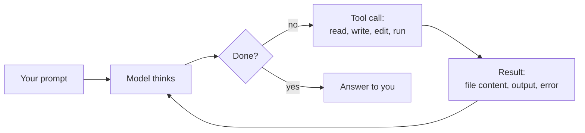

| | Chat | Agent |
|---|---|---|
| Sees your files | Only what you paste | Reads them itself |
| Runs code | No, you do | Yes, and reads the output |
| Fixes its errors | Only if you paste the error back | Yes, in the loop |
| Leaves results | Text in a chat window | Files on your disk: `analyse.py`, `pendulum.png`, `report.md`, and the `.venv` with its packages |
| Your job | Copy, paste, run | Give clear tasks, **check the results** |

The last row matters most. The agent can be confidently wrong. It found the
centimetre error here because the number was absurd. A small error, say 0,60
typed as 0,61, would pass silently. You are still the scientist.

## If something goes wrong

- **The agent only describes what it would do but does not do it.** Reply
  "Go ahead and do it."
- **"not available for grant"**: your grant cannot use the default model. See
  [Which model](../01-getting-started/05-first-steps.md#which-model).
- **`pip` fails with a network or proxy error.** Ask the agent to try again; if it
  keeps failing, skip the plot and do step 10 without it.
- **The agent stops without a result.** Check whether the expected file exists.
  If not, send the same prompt again, or add "Run the script and show me the
  output" at the end.
- **Activate.ps1 cannot be loaded because running scripts is disabled.** The
  agent tried to activate the venv. Reply "Do not activate; call
  .venv\Scripts\python.exe directly."
- **No module named 'matplotlib'.** The agent ran the system Python. Reply "Use
  .venv\Scripts\python.exe."
- **The numbers differ a little from those above.** Small differences (for example
  9.79 instead of 9.80) are fine. A different order of magnitude is not: ask the
  agent to explain.

<details>
<summary>Going further</summary>

- **Change the data yourself.** Open `pendulum.csv` in Notepad, add a row
  `1,40;23,8`, save, and ask the agent to "run the analysis again". It reads the
  current file, not what it remembers.
- **Plan first.** Ask: "Do not change any files yet. How would you estimate g
  from a straight-line fit of T^2 against L instead of the mean?" The agent only
  reads and proposes. If the plan looks good, reply "Go ahead" and let it do it.
  Does the fit give the same *g*? Why might it not?
- **Undo.** `/undo` takes back the last message and its file changes. It needs a
  Git repository: ask the agent to "initialise a git repository and commit all
  files" first.
- **Look at the code.** Open `analyse.py`. It is about 30–50 lines. Ask the
  agent to explain any line you do not understand.

</details>

---

← Previous: [Create a project folder](01-project-folder.md) · [Exercises overview](README.md) · [Main README](../README.md)
