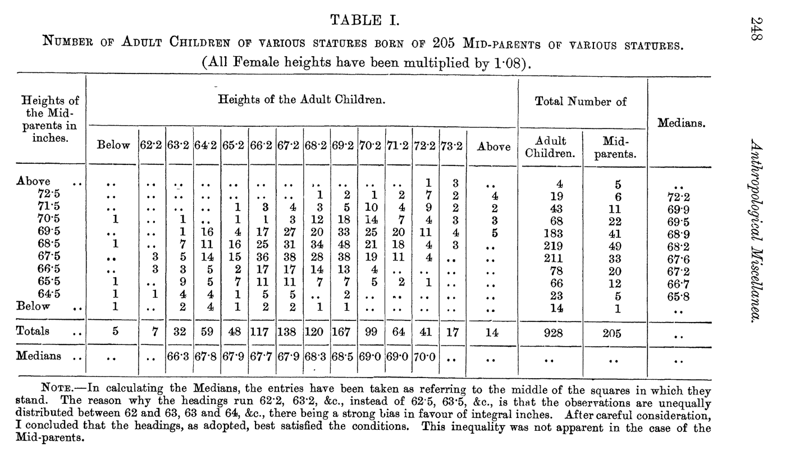
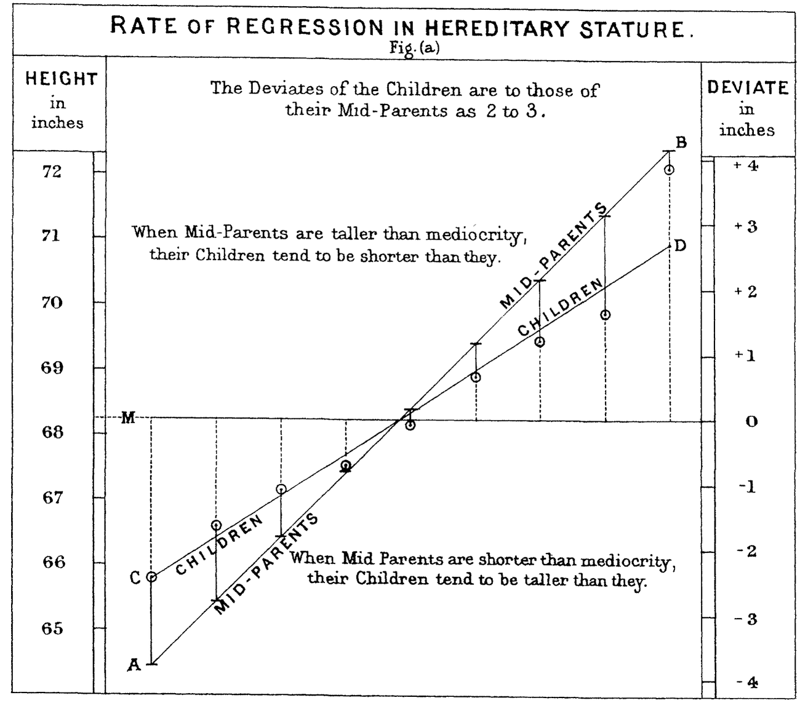
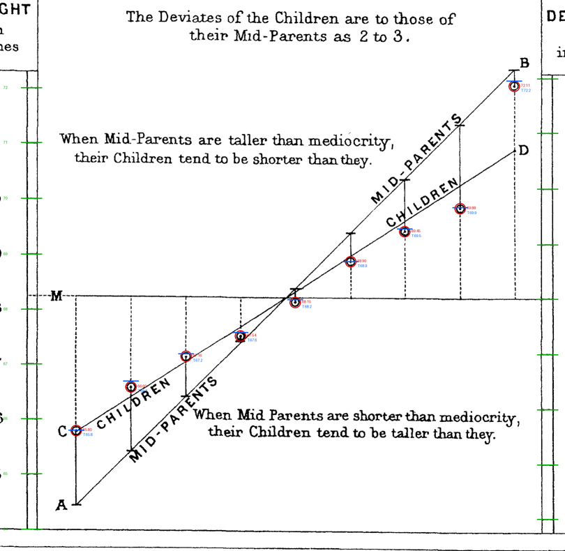

# Exercise 7: where does the word "regression" come from?

Every PhD student does literature research: finding where an idea started,
reading the original paper, and sometimes getting the numbers out of an old
table or plot to check them. An agent can do much of the legwork. It can
search Wikipedia and arXiv, download papers, read PDFs, transcribe a table
and digitize a plot. But it also mixes up sources, trusts the wrong one, and
can invent references.

In this exercise you follow the word **regression** back to its source:
Francis Galton, who studied how the heights of parents and their children are
related. You read what the agent finds online, compare it with what it "knows"
from memory, then go to Galton's own paper of 1886, a scanned PDF in **your**
folder of papers, and get his original numbers out of it.

- You need: [Exercise 4](06-outside-folder.md) (a data folder outside the
  project) and [Exercise 5](07-parallel.md) (subagents). This exercise uses
  both.
- Time: about 90 minutes. Parts E and F can be done in a second sitting.
- You learn: memory versus sources, searching Wikipedia and arXiv with
  subagents, checking that references exist, paywalls and legal copies,
  reading a scanned PDF from your own folder, transcribing a table and
  digitizing a plot, and checking both against the source.

<details>
<summary>Explain: primary and secondary sources</summary>

- A **primary source** is the original: the paper where Galton published his
  data, his notebook, the measurement itself.
- A **secondary source** writes about the primary one: Wikipedia, a history
  paper, a textbook, a review.

Secondary sources are where you start: they are short, and they tell you where
to look. But each retelling can add a small error, and the errors are copied
from one source to the next. A claim that matters is checked in the primary
source.

An agent's **memory** (what the model learned in training) is a secondary
source of unknown origin. It cannot tell you on which page it read something.

</details>

## Part A: prepare

### A1. Create the project folder

Create the folder `kisd-literature` and open it in opencode, as in
[Create a project folder](01-project-folder.md). Put it in the same place as
your other exercise folders, for example **Documents**.

### A2. Fill your own library

A paper that you get from your university library, or from a colleague, ends
up as a PDF somewhere on your disk. Here you play that part yourself, by hand,
in your browser. The agent does not do it.

1. In File Explorer, go to the folder that holds `kisd-literature` (for
   example **Documents**). Create a new folder next to it: **New**, **Folder**,
   name it `kisd-library`. (macOS: Finder, **File**, **New Folder**. Linux:
   your file manager.)
2. Open this address in your browser. It is Galton's paper of 1886, scanned,
   from [galton.org](https://galton.org), the collection of his works:
   <https://galton.org/essays/1880-1889/galton-1886-jaigi-regression-stature.pdf>
   The PDF opens in the browser. Press **Ctrl+S** (macOS: **Cmd+S**) and save
   it into `kisd-library` as `galton-1886-regression.pdf`.
3. Open this address. It is a paper by J. A. Hanley (2004) about Galton's
   original notebook. The journal sells it, but the author offers a free copy
   on his own website:
   <https://jhanley.biostat.mcgill.ca/Reprints/Hanley_Article_Galton_Data.pdf>
   Save it into `kisd-library` as `hanley-2004-galton-data.pdf`.

Expected result: the folder `kisd-library`, next to `kisd-literature`, holds
two PDF files: about 1.1 MB (20 pages) and 0.8 MB (7 pages).

If the browser saved a file into **Downloads** instead, move it into
`kisd-library` in File Explorer, and rename it.

### A3. Get the rules and the permissions

Paste this prompt. The long addresses must stay on one line each:

```text
Download two files into the project folder. The first one:
https://raw.githubusercontent.com/grzanka/kisd-2026-agents-coding/main/02-exercises/literature/AGENTS.md
Save it as AGENTS.md. The second one:
https://raw.githubusercontent.com/grzanka/kisd-2026-agents-coding/main/02-exercises/literature/opencode.json
Save it as opencode.json. Then show me both files. Do nothing else.
```

Expected result: some **Webfetch**, **Write** or **Shell** calls, then the two
files. In short:

| File | What it says |
|---|---|
| `AGENTS.md` | Keep apart what you read in a source and what you know from memory. Give the page of every claim. Never invent a reference. Keep a list of sources in `sources/SOURCES.md`. Do not get around a paywall. Read `../kisd-library`, never change it. |
| `opencode.json` | Ask me before going into any folder outside the project, except `kisd-library`. The agent may read `kisd-library` without asking, but never change it. As in [Exercise 4](06-outside-folder.md). |

### A4. Restart, and prepare the tools

opencode reads `opencode.json` when it starts. Close the opencode app
completely, open it again, and choose the project `kisd-literature`. Start a
new session (**+** or **Ctrl+T**), so that the agent also reads `AGENTS.md`.
Then:

```text
Create .venv and install pymupdf, pillow, pandas and matplotlib into it.
Do nothing else.
```

Expected result: several **Shell** calls (a minute or two). `pymupdf` reads
PDF files and turns their pages into images; the others you know from
earlier exercises.

## Part B: what the agent "knows"

### B1. Ask from memory

Before the agent searches anything, find out what the model remembers:

```text
Do not use any tools. Answer from memory only:
where does the statistical word "regression" come from?
Who used it first, when, in which publication, about which data?
Give full references with DOI and page numbers,
and say how sure you are of each one.
```

Expected result: no tool calls, only an answer. It most likely names
**Francis Galton** and his paper of **1886** about the heights of parents and
children, perhaps also sweet peas, and a ratio of **2/3**. It sounds sure.

Write down: which years does it give? Which word did Galton use first? Does it
name Karl Pearson? Which DOIs does it give? You check all of this below.

### B2. Keep it

```text
Save your answer from B1, unchanged, as notes/from-memory.md.
```

**What to notice:** an answer from memory has no page numbers you can open. It
may be right. You do not know yet which parts.

## Part C: search, with two agents at once

### C1. Wikipedia and arXiv in parallel

Two independent searches: a job for two subagents, as in
[Exercise 5](07-parallel.md). Long addresses stay on their own lines:

```text
Search two kinds of sources at the same time. Start two general
subagents in parallel. Neither of them writes sources/SOURCES.md.
1. Wikipedia. Read the articles "Regression toward the mean",
"Regression analysis" (section History) and "Francis Galton".
Use the raw text of each article, as in this address:
https://en.wikipedia.org/w/index.php?title=Regression_toward_the_mean&action=raw
Write notes/wikipedia.md: every statement about where the word
"regression" comes from, with the year, the article and section,
and the references that Wikipedia gives for it.
2. arXiv. Search the arXiv API for papers about Galton and regression:
https://export.arxiv.org/api/query?search_query=all:Galton+AND+all:regression&max_results=20
Ignore papers on Galton-Watson processes, which are about something else.
Download the PDFs of the two most relevant papers into sources/.
Write notes/arxiv.md: what they say about the origin of the word,
with page numbers.
Each subagent reports back to you in at most 5 lines. Wait for both.
```

Expected result: two subagent calls running at the same time. After a few
minutes, two reports, and two notes files.

<!-- TODO: screenshot of the two subagent calls. -->

The arXiv search finds about ten papers. The two most relevant ones are most
likely:

- **arXiv:1508.02942**: Han, Ma and Zhu (2015), *Galton's family heights data
  revisited*;
- **arXiv:2310.00915**: Matsinos (2023), *A discussion on two celebrated
  examples of application of linear regression*.

Among the others: a paper on George Udny Yule and regression, and one called
*Galton's Law of Mediocrity: Why Large Language Models Regress to the Mean*.

**What to notice:** only the main agent writes `sources/SOURCES.md`. Two
subagents that write the same file overwrite each other's work, as you saw in
Exercise 5.

<details>
<summary>Explain: why the raw Wikipedia address, and what an API is</summary>

- The normal Wikipedia page is a large HTML file, full of menus. The address
  with `action=raw` gives only the text of the article, with its references,
  in a few dozen kilobytes. That is cheaper for the agent to read: fewer
  tokens.
- An **API** (application programming interface) is an address made for
  programs, not for people. The arXiv API answers a search with a list of
  papers in XML: titles, authors, abstracts, links. The agent reads that list
  instead of clicking through the arXiv website.
- Both services ask programs to identify themselves and not to send many
  requests quickly. Wikipedia refuses some programs that do not (HTTP error
  403); see "If something goes wrong".

</details>

### C2. One list of sources

```text
Add every source from notes/wikipedia.md and notes/arxiv.md
to sources/SOURCES.md, in the form that AGENTS.md asks for.
```

Expected result: a **Write** or **Edit** of `sources/SOURCES.md`: one line per
source, with the date you accessed it. A Wikipedia article changes over time,
so the date matters.

### C3. Compare

```text
Compare notes/from-memory.md, notes/wikipedia.md and notes/arxiv.md.
Make a table: one row per claim (who, when, which word, which data,
which ratio), one column per source. Mark where they disagree.
Save it as notes/comparison.md.
```

Expected result: a table, with some rows marked. The sources do not quite
agree with each other, and some contain errors.

<details>
<summary>Check: what disagrees (open after you look)</summary>

What we found in November 2026 (Wikipedia changes, so yours may differ):

- **The year.** The word "regression" appears in Galton's talk at Aberdeen in
  **1885**, and in his paper of **1886**. In **1877**, about sweet peas, he
  called the same effect **reversion**. Many sources give only 1886.
- **Coined or popularized?** The Wikipedia article "Regression toward the
  mean" says that Galton *popularized* the concept, and two paragraphs later
  that he *coined* the term.
- **A date.** The article "Francis Galton" gives the date of his 1877 lecture
  once as 9 February and once as 19 February. The lecture itself is printed
  under "February 9, 1877".
- **arXiv papers have errors too.** Han et al. (p. 2) date least squares to
  1794. Gauss later said he had used it since the 1790s, but Legendre was
  the first to publish it, in 1805. Matsinos (p. 18) calls Karl Pearson Galton's
  doctoral student. Pearson was a younger colleague, and later his biographer.
- **From memory**, models often write that Pearson coined the word, that
  Galton used least squares (he drew his line by eye), or mix up the ratios
  2/3 (people) and 1/3 (sweet peas).

</details>

**What to notice:** none of these sources is the original. Two that agree may
simply have copied each other. Where they disagree, only the primary source
settles it.

### C4. Do the references exist?

A model can write a reference that looks right and does not exist. Check the
ones from B1, in the public catalogue of DOIs, Crossref:

```text
Check every reference in notes/from-memory.md in Crossref.
Look up each DOI at https://api.crossref.org/works/ followed by the DOI.
For a reference without a DOI, search by title at
https://api.crossref.org/works?query.bibliographic=TITLE&rows=3
Write a table: reference, found or not found, and any detail that differs
(year, pages, journal). Save it as notes/references-check.md.
```

Expected result: a few **Webfetch** or **Shell** calls, and a table. Galton's
paper is found: DOI `10.2307/2841583`, *The Journal of the Anthropological
Institute of Great Britain and Ireland*, volume 15, pages 246–263. Look at the
others:

- A **book** (for example Stigler's *The History of Statistics*, 1986) has no
  DOI. If the model gave one, it is made up, or it belongs to a review of the
  book.
- A DOI that Crossref does not know is made up.
- A reference that exists, but with other pages or another year, is a typical
  error from memory.

**What to notice:** checking that a reference exists is cheap for an agent,
and you should always ask for it before a reference goes into your own paper.
Checking that it **says** what is claimed needs the text itself: Part E.

## Part D: paywalls and your library

### D1. Free or paywalled?

Three papers about the history of regression, which the sources cite.
OpenAlex is a free catalogue of research papers that knows which ones are
free to read:

```text
Check whether these three papers are free to read. For each, look up
https://api.openalex.org/works/doi: followed by the DOI,
and report the field open_access. Do not download any paper.
Stigler 1997, DOI 10.1177/096228029700600202
Hanley 2004, DOI 10.1198/000313004X1558
Stanton 2001, DOI 10.1080/10691898.2001.11910537
Add the results to sources/SOURCES.md.
```

Expected result:

| Paper | Free? |
|---|---|
| Stigler 1997, *Regression towards the mean, historically considered* | No: **closed**, paywalled |
| Hanley 2004, *"Transmuting" women into men: Galton's family data on human stature* | Closed at the journal; a free copy on the author's website (you saved it in A2) |
| Stanton 2001, *Galton, Pearson, and the peas* | Yes: open access |

If the agent also tries the publisher's page, it most likely gets an error
(HTTP 403): publishers block programs, even for papers that your university
pays for.

<details>
<summary>Explain: paywalls, and what the agent may do about them</summary>

- **Your university pays** for many journals. Your browser gets in, because
  it is in the university network or you are logged in. The agent's tools are
  not logged in, and do not get in.
- **Legal free copies** often exist: the author's own website (as for
  Hanley), arXiv, the university's repository. OpenAlex and Unpaywall find
  them.
- **Shadow libraries** offer copies of paywalled papers without permission.
  The rule in `AGENTS.md` forbids them. An agent without such a rule may
  suggest them, or try one, without saying so: watch the addresses in its
  tool calls.
- So the work is split: **you get the paper** (library, interlibrary loan, an
  e-mail to the author), and put it into your library folder. **The agent
  reads it** from there.

</details>

### D2. What is in your library?

```text
List the PDF files in ../kisd-library. For each: title, number of
pages, and whether it has a text layer or is only a scanned image.
Add both to sources/SOURCES.md, marked "local copy".
```

Expected result: a **Shell** or **Read** call into `kisd-library`, without a
question from opencode: the folder is allowed. Two files: Galton 1886, 20
pages, a scan **with** a text layer made by text recognition (OCR); Hanley
2004, 7 pages, a normal PDF.

If opencode asks for permission for `kisd-library`, the path did not match
the pattern in `opencode.json`; click **Allow once**, and see "If something
goes wrong".

## Part E: the primary source

The notes are in files, so you can start fresh. Start a **new session**
(**+** or **Ctrl+T**).

### E1. What does Galton himself say?

```text
Read pages 1 and 2 of ../kisd-library/galton-1886-regression.pdf
with a Python script (journal pages 246 and 247).
In your own words: where and when did Galton first speak about
"regression", which earlier work does he mention, and what did that
earlier work show? Give page numbers. Save notes/galton-1886.md.
```

Expected result: a script that extracts the text, and an answer:

- p. 246: the paper gives the data behind the "Law of Regression" from his
  Presidential Address to Section H (Anthropology) of the British
  Association at **Aberdeen**, published in *Nature* on 24 September
  (**1885**).
- p. 246: years earlier, he grew **seeds** of different sizes and presented
  the results at the Royal Institution on **9 February 1877**. The offspring
  seeds were "more mediocre" than their parents: closer to the average.

The extracted text may look strange: letters spaced apart ("th e B ritis h").
That is the OCR of an old scan. The model reads it anyway.

### E2. The first word: reversion

The 1886 paper never uses the old word. The 1877 lecture is free, on
galton.org:

```text
Download this file into sources/ as galton-1877-typical-laws.pdf:
https://galton.org/essays/1870-1879/galton-1877-roy-soc-typical-laws-heredity.pdf
Find the page where Galton defines the word he used then for the
effect. Quote that one definition, give the journal page number,
and add the source to sources/SOURCES.md.
```

Expected result: the word is **Reversion**. Galton defines it on journal page
**291** (page 10 of the PDF): the tendency of the offspring to depart from
the parents, back toward the average of the ancestors. The PDF page and the
journal page differ: the agent must read the page number printed on the page.

### E3. Table I: read it from the image

Galton's paper contains his data as a table: 928 adult children, sorted by
their height and by the height of their "mid-parent" (the average of father
and 1.08 × mother).

```text
Render PDF page 3 of ../kisd-library/galton-1886-regression.pdf
(Table I) as results/table-i.png at 300 dpi, and look at the image.
Then extract the text of the same page. Is the text good enough
to rebuild the table? Show me the first 10 lines of the text.
```

Expected result: a **Shell** call that renders the page, a **Read** of the
image, and the answer **no**. In the text, decimal points are lost (`725`
instead of `72.5`), and empty cells disappear, so you cannot tell which column
a number belongs to. Open `results/table-i.png` (**Open file**):



```text
Transcribe Table I from the image into data/galton-table1.csv.
One row per mid-parent class, one column per class of children,
plus the totals and medians columns, exactly as printed.
Write 0 for an empty cell. Keep "Above" and "Below" as text.
Then check with a script: does every row and every column add up
to its printed total? Are the grand totals 928 and 205?
```

Expected result: a CSV file, a check script, and the answer: **all rows and
columns add up**, 928 children and 205 mid-parents. If a row does not add up,
the agent misread a number. Ask it to look again at that row, on a close-up of
the image. Do not let it "fix" a number so that the sum fits.

**What to notice:** the totals that Galton printed are a free check of your
transcription. Use every check that the source gives you: totals, counts,
a number that is mentioned in the text.

### E4. Digitize a plot

Galton also drew the medians as a plot. Getting numbers out of a plot is
called **digitizing**. It works like the measuring in
[Exercise 6](08-photo.md): pixels, a reference, a check image.

```text
Render PDF page 4 of ../kisd-library/galton-1886-regression.pdf
(Plate IX) as results/plate-ix.png at 300 dpi, and look at it.
Describe the left figure: the scales, the lines, the markers.
```

Expected result: a description close to this. Compare with the image:



- left scale: height in inches, 64 to 72; right scale: deviation from the
  average (68¼ inches, the line M), −4 to +4;
- line A–B, "Mid-parents", and line C–D, "Children", which is less steep;
- nine dashed vertical lines, one for each class of mid-parents, each with a
  small circle with a dot: the median height of the children;
- the text "The Deviates of the Children are to those of their Mid-Parents as
  2 to 3".
- There are **no numbers on the horizontal axis**. A good answer says so.

```text
Digitize the left figure with a Python script in scripts/.
The points are 9 small circles with a dot, one on each dashed
vertical line, for mid-parent heights 64.5, 65.5, ... 72.5.
There are no numbers on the x axis: use these heights as x.
Calibrate y with the ticks of the left scale, 64 to 72 inches.
Save data/plate-ix-digitized.csv, and results/plate-ix-marked.png
with the found points drawn in red. Then look at the marked image.
```

Expected result: a script, perhaps after a few tries, and a marked image.
Open `results/plate-ix-marked.png`: every red mark must sit on a circle, not on
a letter or a line crossing. In our test run:



If a mark is in the wrong place, say which one, for example: "The third point
is on the letter C, not on the circle. Search only near each dashed line."

### E5. Two ways, one answer?

```text
Compare data/plate-ix-digitized.csv with the Medians column
of data/galton-table1.csv. Show the differences in a table.
Then fit a straight line to each set of 9 points: what slopes?
```

Expected result: the digitized medians differ from the table by **0.1 inch or
less**. Both lines have a slope of about **0.68**. Galton drew his line by eye
and wrote 2/3 (0.67).

**What to notice:** two independent ways to get the numbers, the table and the
plot, agree. That is a much better check than a second look at one of them.

## Part F: the original data

### F1. Someone else's transcription

Galton's table was transcribed long ago, and is used in statistics courses
everywhere. Compare yours with it:

```text
Download this file as data/histdata-galton.csv:
https://vincentarelbundock.github.io/Rdatasets/csv/HistData/Galton.csv
It is another transcription of the same Table I, one row per child.
Count it into the same form as data/galton-table1.csv and compare
the two, cell by cell. Which numbers did its authors use for the
classes "Above" and "Below"?
```

Expected result: 928 rows, and the same counts in every cell as your table. The
open classes became numbers: mid-parents "Below" = 64 and "Above" = 73;
children "Below" = 61.7 and "Above" = 73.7.

**What to notice:** to compute with a table, somebody had to **choose** a value
for "Below" and "Above". Every digitized dataset contains such choices. Look
for them, and write yours down.

### F2. Regression, computed

```text
With data/histdata-galton.csv, fit the child's height on the
mid-parent's height by least squares, and the other way round.
Give both slopes and the correlation. Save results/regression.png:
the 9 medians, a line with slope 1, and the fitted line.
Write the data source in the caption.
```

Expected result: slope of children on mid-parents about **0.65**, slope of
mid-parents on children about **0.33**, correlation about **0.46**.

<details>
<summary>Explain: why "regression", and why both slopes are below 1</summary>

Tall parents have children who are, on average, tall, but less so than their
parents. Galton saw the children "go back" toward the average, and called it
regression toward mediocrity (mediocrity then meant simply "the average").

But look at it the other way round: tall children have parents who are, on
average, less tall than they are. Both slopes are below 1. This is not
biology. It happens with **any** two measurements that are related, but not
perfectly: a test and its retest, this year's yield and next year's. Today it
is called **regression toward the mean**. The method of fitting a line got
the name too, and kept it, even where nothing goes back anywhere.

</details>

### F3. Behind the table: Galton's notebook

```text
Read ../kisd-library/hanley-2004-galton-data.pdf. Where are Galton's
original records, who found them and when, and how many families and
children do they contain? How does that compare with Table I?
Give journal page numbers. Then check whether the web address for
the data, given at the end of the paper, still works.
Save notes/hanley-2004.md.
```

Expected result:

- Galton's notebook, "Copies of original data", is in the **Galton Papers at
  University College London**. It was found in March 2001 and photographed in
  2003 (p. 238).
- It lists 963 children of **205 families**, of whom **934** have a height
  as a number (p. 239). Table I has **928**, and Galton's text says 930.
  Hanley could not tell which ones were left out.
- Galton fitted his line **by eye**, through the nine medians (p. 237).
- The address in the paper, `http://www.epi.mcgill.ca/hanley/galton`, **no
  longer works**. A good agent says so, and looks for the new one:
  `https://jhanley.biostat.mcgill.ca/galton/`, with photographs of the
  notebook pages.

**What to notice:** links in papers die. The agent can search for where the
data moved, but you check that the new place is really the same data, from
the same author.

### F4. The family data

Hanley's numbers from the notebook, one row per child, are also in HistData:

```text
Download this file as data/histdata-galton-families.csv:
https://vincentarelbundock.github.io/Rdatasets/csv/HistData/GaltonFamilies.csv
Multiply the heights of daughters by 1.08, as Galton did, and fit the
child's height on midparentHeight. Compare the slope with F2.
```

Expected result: 934 children of 205 families, and a slope of about **0.71**.
From the same families, three numbers: 0.65 (Table I, least squares), 0.67
(Galton, by eye), 0.71 (the notebook, least squares). Each step from the raw
notes to the published table changed a little: rounding into 1-inch classes,
a few children left out.

### F5. The report

```text
Write results/regression-origin.md: a timeline of the word
(1877, 1885, 1886, and who generalised it later), what Table I and
Plate IX show, the slopes from E5, F2 and F4, and where the sources
disagreed. Every claim with its source and page. Mark anything
from memory. End with the list of sources from sources/SOURCES.md.
```

Expected result: a **Write** of the report, after a few **Read** calls of the
notes. Read it, and check two claims yourself: open the PDF in your library at
the page given. Is it there?

## Take home: literature research with an agent

| The agent is good at... | You must still... |
|---|---|
| Searching many sources quickly, in parallel | Decide which sources count, and go to the primary one |
| Reading long PDFs and finding the page | Check the key claims on that page yourself |
| Checking that a reference exists (Crossref, OpenAlex) | Never put a reference into a paper that nobody checked |
| Transcribing a table, digitizing a plot | Check against the totals, a second method, or a second transcription |
| Reading the papers in your library folder | Get paywalled papers yourself, legally; keep the folder read-only |

Rules of thumb:

1. **Ask first what the agent "knows", and keep it.** Then compare with the
   sources. Memory is a secondary source without page numbers.
2. **Ask for the page of every claim**, and keep a list of sources with the
   date you accessed them.
3. **Check that references exist** before you use them.
4. **Secondary sources disagree, and copy each other's errors.** Go to the
   primary source for anything that matters.
5. **A scanned PDF needs a look at the image**, not only the text layer.
6. **Use every check the source gives you**: totals, counts, a second figure.

## Check yourself

No prompt here. Answer on paper, or explain to your neighbour:

1. Which word did Galton use in 1877, and which in 1885? How do you know?
2. Why was the answer from memory in B1 not enough, even where it was right?
3. Why did only the main agent write `sources/SOURCES.md`?
4. Why can the agent not read a paper that your university pays for, while
   you can?
5. How did you check the transcription of Table I? Name two checks.
6. Why are there three slopes (0.65, 0.67, 0.71) for the same families?

## If something goes wrong

- **Wikipedia answers with error 403.** The agent used a Python script
  without a name for itself. Tell it: "Use the webfetch tool, or set a
  User-Agent header that names this project."
- **The arXiv search returns papers about Galton-Watson processes.** These are
  about family trees in probability, not about regression. Tell the subagent
  to ignore them, or search with `abs:Galton+AND+abs:stature`.
- **The agent tries to get Stigler 1997 from another website.** Look at the
  address in the tool call. If it is not the publisher, the author, or an
  open repository, click **Deny** (if opencode asks), and remind it of the
  rule about paywalls in `AGENTS.md`.
- **opencode asks for permission for `kisd-library`.** Check that the folder
  is called exactly `kisd-library` and is next to `kisd-literature`, and that
  you restarted opencode after A3.
- **The agent says it cannot see images.** The model you chose cannot read
  images. Check that you use a model marked **(PLGrid)** from the course
  settings (see [First steps in opencode](../01-getting-started/05-first-steps.md)).
  If it still cannot, be its eyes: open `results/table-i.png` yourself, and
  type the numbers of one row at a time into the prompt.
- **The digitized points are far off (more than 0.3 inch).** Ask the agent
  which pixel rows it used for 64 and 72 inches, and to draw them on the
  marked image. Usually it took a wrong tick, or a text line, as the scale.
- **galton.org does not answer.** The same scan is on Zenodo, free (licence
  CC0): <https://zenodo.org/records/1449548>. Its first page is a cover sheet,
  so all page numbers in the prompts are one higher.

<details>
<summary>Going further</summary>

- **A checker for citations.** As in [Exercise 5](07-parallel.md), ask an
  Explore subagent to check every page number in
  `results/regression-origin.md` against the PDFs. It can only read, so it
  cannot "fix" the report to fit.
- **Plate X.** Page 5 of Galton's PDF is one of the first drawings of what
  is today called a bivariate normal distribution: ellipses of equal
  frequency. Ask
  the agent to explain it, and to draw the same from
  `data/histdata-galton.csv`.
- **The notebook itself.** Hanley's website has photographs of Galton's
  handwritten pages. Ask the agent to read the first family from the photo
  and compare it with the first rows of `histdata-galton-families.csv`.
  Handwriting is harder than print: check every number.
- **Your own field.** Pick a term or a constant that everybody in your field
  uses. Ask the agent to find its first use, with the page, and check it.
- **A reference manager.** Ask the agent to turn `sources/SOURCES.md` into a
  BibTeX file that Zotero or LaTeX can read. Check every entry in Crossref.

</details>

---

← Previous: [Exercise 6](08-photo.md) · [Exercises overview](README.md) · [Main README](../README.md)
