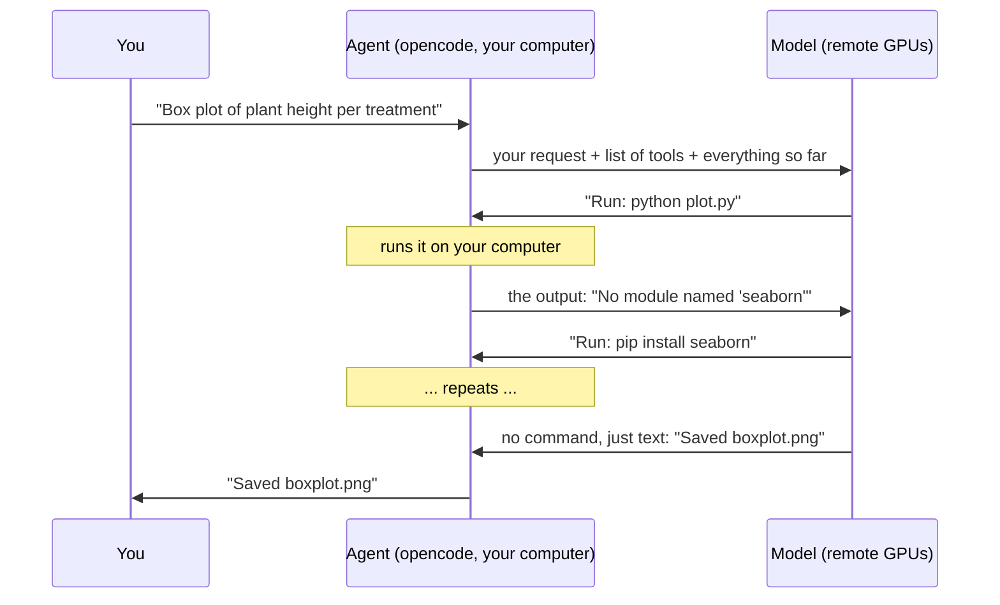

# 1. Chatbot or agent: who runs the loop?

You probably know chatbots such as ChatGPT, Gemini or Claude.ai: a web page
where you ask, and a **model** (large language model, LLM) answers. opencode,
the tool in this course, is an **AI agent**. It uses the same kind of model, but
works differently.

## Chatbot: you are the loop

You ask → the model answers with some code → **you** copy it, run it, and paste
the errors back → repeat. Every step is by hand. The chatbot never sees your
files or your computer.

## Agent: the program runs the loop

The agent is a program on **your computer**. You describe the task, for example
*"Make a box plot of plant height per treatment from `plants.csv`"*. The agent
asks the model what to do, then writes the code, runs it, reads the output,
fixes the errors and tries again until the task is done. You approve risky
steps and check the result.

| | Chatbot | Agent |
|---|---|---|
| Where it runs | A web page | A program on your computer (opencode) |
| Your data | You upload or paste it, size-limited | Read and written directly in your folder |
| Code | Short pieces you copy by hand | Whole scripts, created and edited in place |
| Running the code | You do it, or a short-lived sandbox in the cloud | Your computer, as long as needed |
| Results | What the web page can show | Files in your folder: tables, plots, reports |

## How one task runs

The model runs on remote GPUs (here: the PLGrid supercomputers at Cyfronet). It
only receives text and sends text back. **It never touches your computer: the
agent program does.**

A real run of this task might look like this:

1. Write `plot.py` and run it → *No module named 'seaborn'*
2. Install the missing package, run again → *no column 'height'*
3. Look inside the file → the column is called `height_cm`
4. Fix the script, run again → *saved boxplot.png*. Done.

## Why one prompt costs many model calls

- **Many passes.** One prompt often means tens or hundreds of model calls,
  one per step above.
- **Everything is sent again.** The model keeps no memory. Each call sends the
  whole history: your request, every command and every output. The history only
  grows.
- **There is a limit.** The model can read about a million **tokens** (pieces of
  words) at once. Near the limit, opencode summarises older messages.
- **You pay per token.** On llmlab, every call uses credits from your grant.
  Small, clear tasks are cheaper and work better.

---

[Docs overview](README.md) · Next: [2. Install the opencode app →](02-install-opencode.md)
