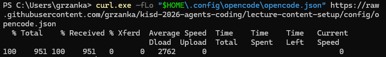
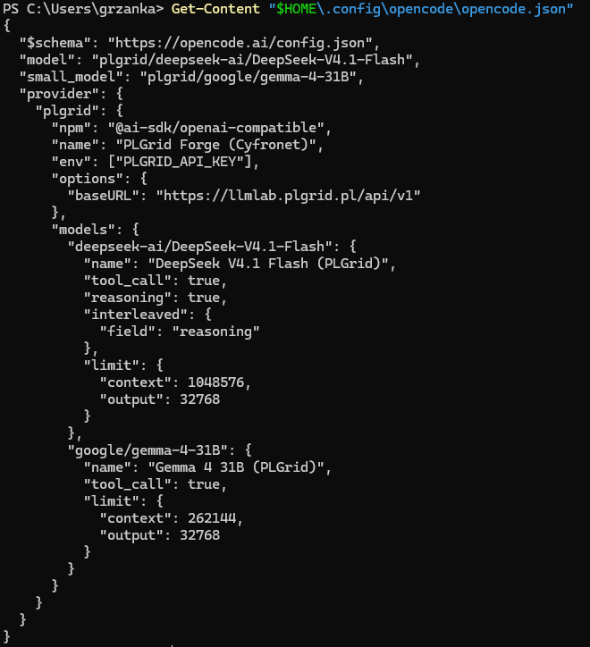
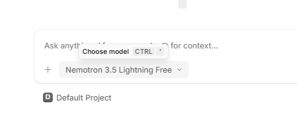
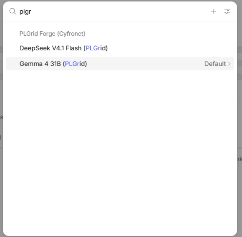
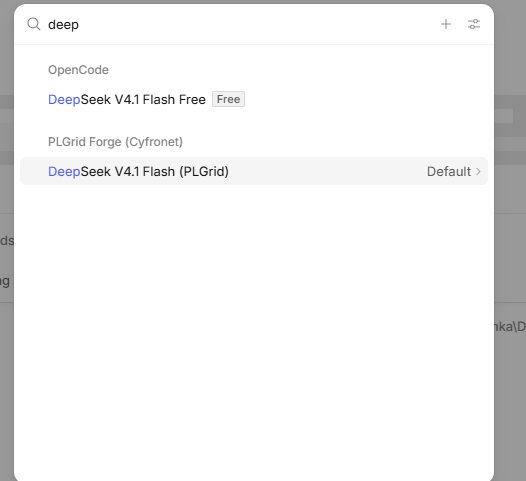
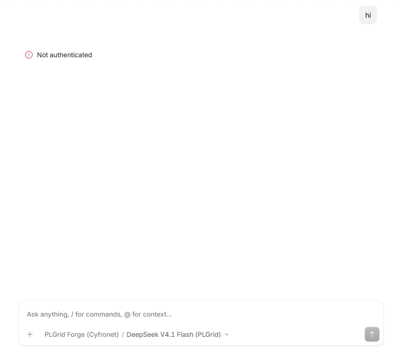

# 3. Configure opencode for llmlab, part 1: the address

opencode must know where llmlab is and which models it has. The app has no
screen where you can type this in. Instead, you download a small ready-made
settings file from this course repository. You do not need Git.

At the end of this page, llmlab shows up in opencode, but does not work yet:
it still needs your API key ([part 2](04-configure-llmlab-api-key.md)).

Close opencode before you start.

## Step 1. Open PowerShell

Press the **Windows** key, type `PowerShell`, and press **Enter**. A window with
a blinking cursor opens. This is a terminal: you type a command, press
**Enter**, and the computer runs it.

## Step 2. Create the folder

opencode reads its settings from one fixed place in your user folder:
`.config\opencode\opencode.json`. On a new computer the `.config\opencode`
folder does not exist yet. The download in step 3 only saves a file; it does
not create missing folders, and fails if the folder is not there. So create it
first:

```powershell
mkdir -Force "$HOME\.config\opencode"
```

`$HOME` is your user folder, for example `C:\Users\yourname`. `-Force` means:
create the folder, and do not complain if it already exists.

Expected result (with your own user name and date): a short table with the new
folder `opencode`.


## Step 3. Download the settings file

```powershell
curl.exe -fLo "$HOME\.config\opencode\opencode.json" https://raw.githubusercontent.com/grzanka/kisd-2026-agents-coding/lecture-content-setup/config/opencode.json
```

Expected result: a small progress table. The first column of the last line is
`100` (100% downloaded). The other numbers may differ:



Type `curl.exe`, not `curl`: in Windows PowerShell, `curl` is a different
command. `curl.exe` is part of Windows 10 (since 2018) and Windows 11.

> [!WARNING]
> If you already had your own `opencode.json` in that folder, this command
> replaces it. Most participants do not have one.

<details>
<summary>Explain: what does <code>-fLo</code> mean?</summary>

- `-f` (fail): if the server answers with an error, stop and say so, instead of
  saving the error page as your settings file.
- `-L` (location): follow a redirect if the server sends one.
- `-o` (output): save to this file instead of printing it on the screen.

</details>

<details>
<summary>No <code>curl.exe</code>? Use one of these instead</summary>

If you see *curl.exe is not recognized*, your Windows is older than 2018. Use
the PowerShell download command instead. It works on every Windows:

```powershell
Invoke-WebRequest -Uri "https://raw.githubusercontent.com/grzanka/kisd-2026-agents-coding/lecture-content-setup/config/opencode.json" -OutFile "$HOME\.config\opencode\opencode.json"
```

Expected result: no output, the cursor just returns.

Or download it with a web browser: open the address above, press **Ctrl+S**,
and save it as `opencode.json` in `C:\Users\yourname\.config\opencode`. Set
*Save as type* to **All files**, otherwise Windows may name it
`opencode.json.txt`, and opencode will not find it.

</details>

<details>
<summary>Linux / macOS</summary>

One command creates the folder and downloads the file:

```bash
curl -fL --create-dirs -o ~/.config/opencode/opencode.json https://raw.githubusercontent.com/grzanka/kisd-2026-agents-coding/lecture-content-setup/config/opencode.json
```

</details>

<details>
<summary>Errors</summary>

- *Failed to open the file ... No such file or directory* or *curl: (23)*: the
  folder does not exist. Run step 2, then download again.
- *Could not resolve host* or a timeout: check your internet connection.
- *The requested URL returned error: 404*: the address was not copied in full.
  Copy the whole block again.

</details>

## Step 4. Check the file

Show the content of the file on the screen:

```powershell
Get-Content "$HOME\.config\opencode\opencode.json"
```

Expected result: the settings text. Look for the llmlab address
`https://llmlab.plgrid.pl/api/v1` and the two model names:



<details>
<summary>Explain: what is in the file?</summary>

The file [config/opencode.json](../config/opencode.json) tells opencode:

- the address of llmlab: `https://llmlab.plgrid.pl/api/v1`;
- two models, with their limits (how much text each can read and write at once):
  `deepseek-ai/DeepSeek-V4.1-Flash` as the default, and `google/gemma-4-31B`
  as a fallback;
- to use Gemma for the short session titles, so no text goes to opencode's
  free models;
- that the API key comes separately: you paste it in the opencode app in
  [part 2](04-configure-llmlab-api-key.md). The key itself is never written in
  this file.

</details>

## Step 5. Check that opencode sees llmlab

Start opencode: press the **Windows** key, type `opencode`, and press **Enter**.
If it was already open, close it completely first, so that it reads the new
settings.

Under the text box you still see a free model, here *Nemotron 3.5 Lightning
Free*. That is expected: opencode keeps a free model until it has your key.

Click the model name (or press **Ctrl+'**). The model list opens.



In the search box at the top of the list, type `plgr`.

Expected result: a group **PLGrid Forge (Cyfronet)** with two models,
**DeepSeek V4.1 Flash (PLGrid)** and **Gemma 4 31B (PLGrid)**. This means
opencode has read the settings file. The word *Default* on the highlighted row
is a button; you can ignore it.



If the search finds nothing, opencode did not read the file. Repeat step 4, then
close opencode completely and start it again.

Press **Esc** to close the list. Do not chat yet: first get your API key on the
next page.

### Two models called DeepSeek

If you type `deep` instead, you see two DeepSeek models in two groups:



| In the list | Group | Who runs it | Use it in this course? |
|---|---|---|---|
| DeepSeek V4.1 Flash **Free** | OpenCode | opencode's free service, outside PLGrid | **No** |
| DeepSeek V4.1 Flash **(PLGrid)** | PLGrid Forge (Cyfronet) | llmlab, on PLGrid computers, paid by your grant | **Yes** |

It is the same model, run by two different services. Your text goes to the one
you pick. Always check the group name, and pick the one with **(PLGrid)**.

### If you start chatting too early

If you pick a PLGrid model and send a message before part 2, opencode shows a
red **Not authenticated**:



Nothing is broken and no credits are used: llmlab refused the message because
opencode has no key yet. Do part 2, then send the message again.

If you chat with the free model that is selected at the start, it answers, but
your text goes to opencode's free service, not to PLGrid. Do not paste your
research data there.

---

← Previous: [2. Install the opencode app](02-install-opencode.md) · [Docs overview](README.md) · Next: [4. Configure opencode for llmlab, part 2: the API key →](04-configure-llmlab-api-key.md)
