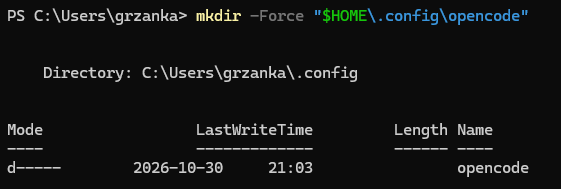

# 3. Configure opencode for llmlab, part 1: the address

opencode must know where llmlab is and which models it has. The app has no
screen where you can type this in. Instead, you download a small ready-made
settings file from this course repository. You do not need Git.

At the end of this page, llmlab shows up in opencode, but does not work yet:
it still needs your API key ([part 2](04-configure-llmlab-api-key.md)).

Close opencode before you start.

## Step 1. Open PowerShell

Press the **Windows** key, type `PowerShell`, and press **Enter**. A window with
a blinking cursor opens. This is a terminal: you type a command, press
**Enter**, and the computer runs it.

## Step 2. Create the folder

opencode reads its settings from one fixed place in your user folder:
`.config\opencode\opencode.json`. On a new computer the `.config\opencode`
folder does not exist yet. The download in step 3 only saves a file; it does
not create missing folders, and fails if the folder is not there. So create it
first:

```powershell
mkdir -Force "$HOME\.config\opencode"
```

`$HOME` is your user folder, for example `C:\Users\yourname`. `-Force` means:
create the folder, and do not complain if it already exists.

Expected result (with your own user name and date):

<!-- Trying two ways to show output without a copy button: <pre> and a screenshot. Keep one. -->

<pre>
    Directory: C:\Users\yourname\.config


Mode                 LastWriteTime         Length Name
----                 -------------         ------ ----
d-----        2026-10-30     21:03                opencode
</pre>



## Step 3. Download the settings file

```powershell
curl.exe -fLo "$HOME\.config\opencode\opencode.json" https://raw.githubusercontent.com/grzanka/kisd-2026-agents-coding/lecture-content-setup/config/opencode.json
```

Expected result: a small progress table. The first column of the last line is
`100` (100% downloaded). The other numbers may differ:

```text
  % Total    % Received % Xferd  Average Speed  Time    Time    Time   Current
                                 Dload  Upload  Total   Spent   Left   Speed
100    960 100    960   0      0   2202      0                              0
```

Type `curl.exe`, not `curl`: in Windows PowerShell, `curl` is a different
command. `curl.exe` is part of Windows 10 (since 2018) and Windows 11.

> [!WARNING]
> If you already had your own `opencode.json` in that folder, this command
> replaces it. Most participants do not have one.

<details>
<summary>Explain: what does <code>-fLo</code> mean?</summary>

- `-f` (fail): if the server answers with an error, stop and say so, instead of
  saving the error page as your settings file.
- `-L` (location): follow a redirect if the server sends one.
- `-o` (output): save to this file instead of printing it on the screen.

</details>

<details>
<summary>No <code>curl.exe</code>? Use one of these instead</summary>

If you see *curl.exe is not recognized*, your Windows is older than 2018. Use
the PowerShell download command instead. It works on every Windows:

```powershell
Invoke-WebRequest -Uri "https://raw.githubusercontent.com/grzanka/kisd-2026-agents-coding/lecture-content-setup/config/opencode.json" -OutFile "$HOME\.config\opencode\opencode.json"
```

Expected result: no output, the cursor just returns.

Or download it with a web browser: open the address above, press **Ctrl+S**,
and save it as `opencode.json` in `C:\Users\yourname\.config\opencode`. Set
*Save as type* to **All files**, otherwise Windows may name it
`opencode.json.txt`, and opencode will not find it.

</details>

<details>
<summary>Linux / macOS</summary>

One command creates the folder and downloads the file:

```bash
curl -fL --create-dirs -o ~/.config/opencode/opencode.json https://raw.githubusercontent.com/grzanka/kisd-2026-agents-coding/lecture-content-setup/config/opencode.json
```

</details>

<details>
<summary>Errors</summary>

- *Failed to open the file ... No such file or directory* or *curl: (23)*: the
  folder does not exist. Run step 2, then download again.
- *Could not resolve host* or a timeout: check your internet connection.
- *The requested URL returned error: 404*: the address was not copied in full.
  Copy the whole block again.

</details>

## Step 4. Check the file

Show the content of the file on the screen:

```powershell
Get-Content "$HOME\.config\opencode\opencode.json"
```

Expected result: the settings text, starting like this:

```text
{
  "$schema": "https://opencode.ai/config.json",
  "model": "plgrid/deepseek-ai/DeepSeek-V4.1-Flash",
  "small_model": "plgrid/google/gemma-4-31B",
  "provider": {
    "plgrid": {
      "npm": "@ai-sdk/openai-compatible",
      "name": "PLGrid Forge (Cyfronet)",
      "env": ["PLGRID_API_KEY"],
      "options": {
        "baseURL": "https://llmlab.plgrid.pl/api/v1"
```

<details>
<summary>Explain: what is in the file?</summary>

The file [config/opencode.json](../config/opencode.json) tells opencode:

- the address of llmlab: `https://llmlab.plgrid.pl/api/v1`;
- two models, with their limits (how much text each can read and write at once):
  `deepseek-ai/DeepSeek-V4.1-Flash` as the default, and `google/gemma-4-31B`
  as a fallback;
- to use Gemma for the short session titles, so no text goes to opencode's
  free models;
- where to find your API key: saved in the opencode app, or in a Windows setting
  called `PLGRID_API_KEY` ([part 2](04-configure-llmlab-api-key.md)). The key
  itself is never written in this file.

</details>

## Step 5. Check that opencode sees llmlab

<!-- TODO: confirm what the desktop app shows without a key; add screenshots. -->

Start opencode: press the **Windows** key, type `opencode`, and press **Enter**.

1. Click the model name under the text box. The model list opens.
2. At the bottom, click **See 70+ more providers**. The **Integrations** window
   opens.
3. In its search box, type `plgrid`.

Expected result: **PLGrid Forge (Cyfronet)** appears in the list. This means
opencode has read the settings file. Do not click it yet: first get your API key
on the next page.

If the search finds nothing, opencode did not read the file. Repeat step 4, then
close opencode completely and start it again.

---

← Previous: [2. Install the opencode app](02-install-opencode.md) · [Docs overview](README.md) · Next: [4. Configure opencode for llmlab, part 2: the API key →](04-configure-llmlab-api-key.md)
