# 4. Configure opencode for llmlab, part 2: the API key

After [part 1](03-configure-llmlab-endpoint.md), opencode knows where llmlab is.
Now it needs your **API key**, so that llmlab lets it in and bills your grant.

llmlab (PLGrid Forge) runs large language models on the PLGrid supercomputers
at ACK Cyfronet, <https://llmlab.plgrid.pl>. Your prompts and data are processed
in Poland, on PLGrid hardware, and not by a commercial cloud.

- Usage is paid in **credits** from a PLGrid **grant**. The more text the model
  reads and writes, the more credits it uses.
- PLGrid administrators cannot see your prompts or the answers.

## An API key, never your password

> [!CAUTION]
> Never give opencode, or any program, script or settings file, your **PLGrid
> password**. Use an **API key**, made only for this purpose.

An **API key** is a long secret string that lets a program (here, opencode) use
one service on your behalf. It is not the same as your password:

| | Your PLGrid password | An API key |
|---|---|---|
| What it opens | Everything: the PLGrid portal, your grants, the supercomputers, your files there | One service only: llmlab |
| How many | One | As many as you like: one per project, per computer, per course |
| How long it works | Until you change it | Until the expiry date you set |
| Spending limit | None | A credit quota you set |
| If it leaks | Someone controls your whole account, in your name; you change the password everywhere | You archive that one key in a minute; the others keep working |

Why this matters with an agent: an agent reads and writes many files, and its
settings and notes get copied, zipped, sent to colleagues or put on GitHub.
Sooner or later a secret in such a file ends up where it should not be. A leaked
key costs at most its credit quota. A leaked password can cost your account, your
grant and your data.

Saving your password once would be quicker than making keys. Take the extra five
minutes anyway: it is the cheapest insurance you will ever buy.

Also: never paste the key into the opencode chat. Everything you type there is
sent to the model.

## Step 1. Get an API key

You need a PLGrid account and membership in a team with a **grant** that has LLM
credits. Ask the course organisers which grant to use.

### 1a. Activate the llmlab service

Go to <https://portal.plgrid.pl/services/111> and log in with your PLGrid
account. This is the service *Access to Large Language Models at the Cyfronet
centre [grant required]*. Click **Activate**.

Expected result: the green label **Active**. Activation may take a while; if
you still see **Activate**, try again later. Do not click **Deactivate**.

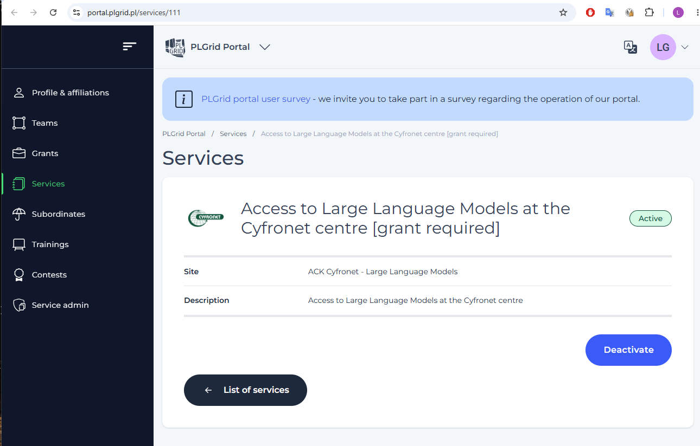

### 1b. Log in to llmlab

Go to <https://llmlab.plgrid.pl> and click **Log in to the service**. Log in
with your PLGrid account.

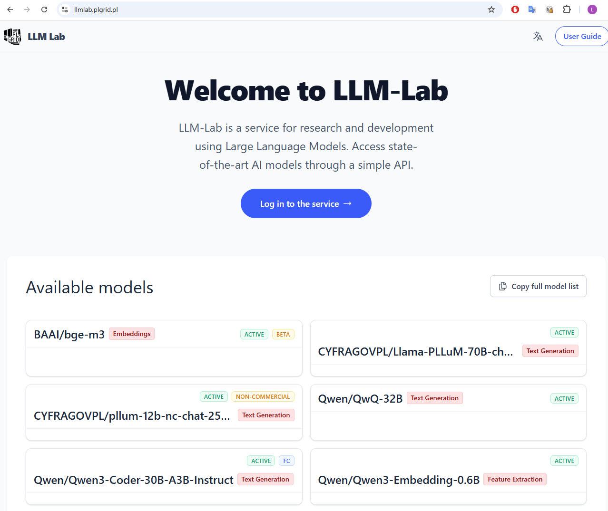

### 1c. Choose your grant

You land on **Grants**, the list of your active grants. Each shows the credits
used and the total, here 6,052 of 10,000. Click **Generate API Key** next to the
course grant.

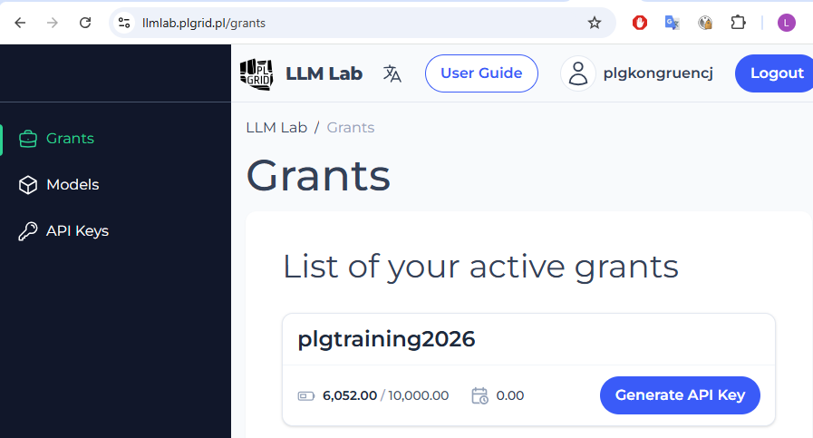

On the next page, **Actions**, click **Generate**.

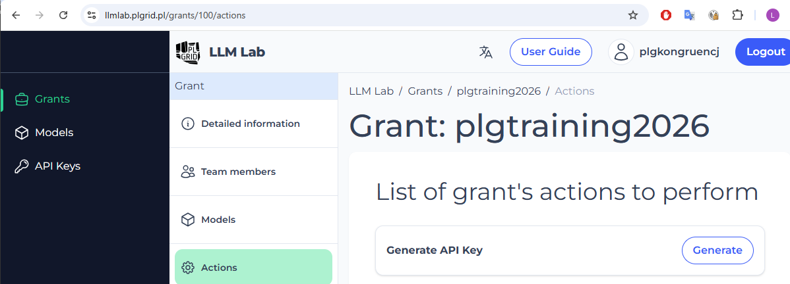

### 1d. Fill in the form

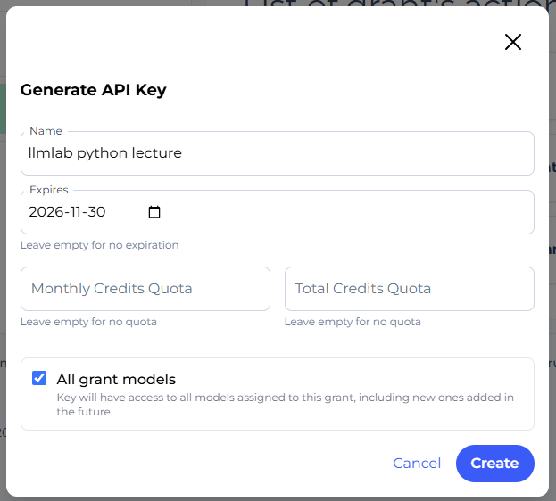

| Field | What to enter |
|---|---|
| **Name** | What the key is for, for example `kisd course, my laptop`. You will see it in the list of keys. |
| **Expires** | A date soon after the course ends. An empty field means the key never expires: avoid that. |
| **Monthly Credits Quota** | The most this key may spend per month. An agent can use many credits quickly; the quota protects you if the key leaks or a session runs away. |
| **Total Credits Quota** | The most this key may spend in total. Optional. |
| **All grant models** | Leave it ticked. |

Click **Create**.

### 1e. Copy the key now: it is shown only once

> [!IMPORTANT]
> The key is shown **only once**, right after you click **Create**. When you
> leave or reload the page, it is gone, and nobody can show it to you again,
> not even the administrators.

Click the copy button on the right of the key, and go straight on to step 2.

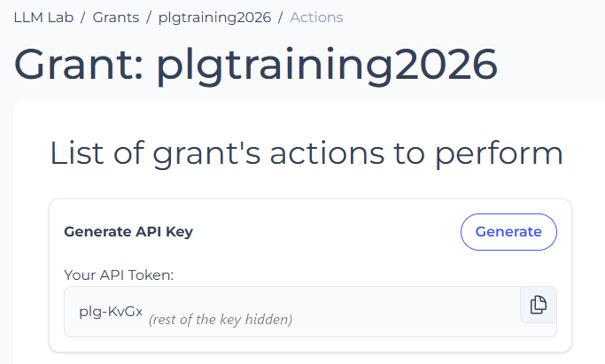

Your key starts with `plg-` and is about 45 characters long. In the picture
above most of it is hidden: never use a key from a picture, page or file you
did not create yourself.

If you lost the key before you used it, nothing is broken: generate a new one,
and archive the old one in **API Keys** (step 1f).

### 1f. Your keys in the list

Under **API Keys → Active Keys** you see all your keys: name, grant, the first
characters of the key, the expiry date and the models it can use. The full key is
not shown here. The **⋮** menu on the right of a key lets you archive it, so it
stops working.

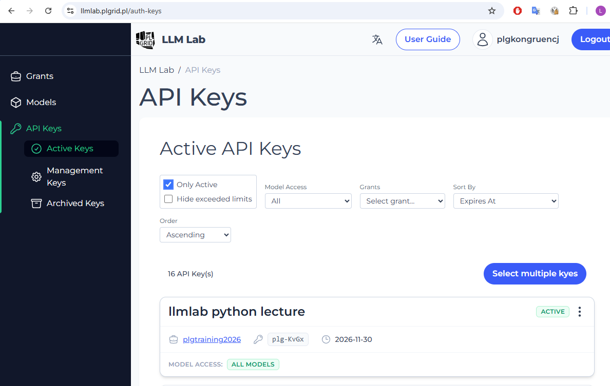

## Step 2. Give the key to opencode

You paste the key once into opencode. It keeps it for the next times.

### 2a. Start a new session

If opencode is not running, start it: press the **Windows** key, type
`opencode`, and press **Enter**. Then start a new, empty session: click the
**+** at the top of the window (or press **Ctrl+T**).

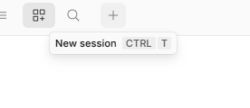

### 2b. Open the list of providers

In the text box, type `/conn`. A list of commands appears. Click **/connect**
(or press **Enter**).

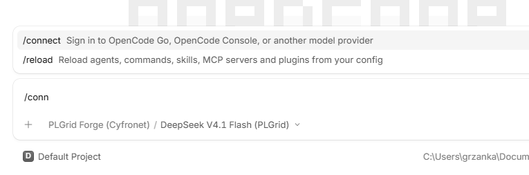

Expected result: the **Integrations** window, with a long list of services.

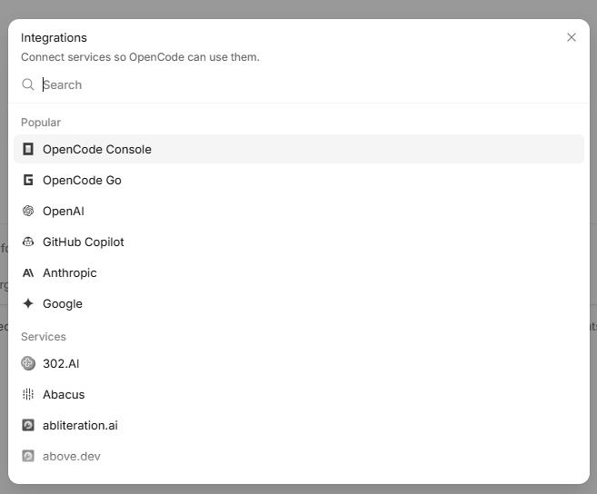

### 2c. Find PLGrid Forge

In the search box, type `cyfron`. Click **PLGrid Forge (Cyfronet)**.

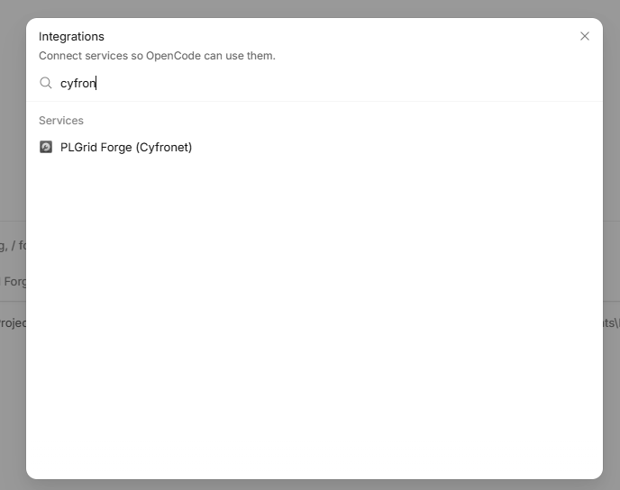

If the search finds nothing, opencode did not read the settings file: go back to
[part 1](03-configure-llmlab-endpoint.md), step 5.

### 2d. Paste the key

A window **Connect PLGrid Forge (Cyfronet)** opens, with one field for the API
key.

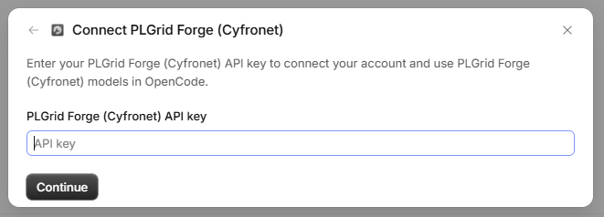

Click the field, paste your key with **Ctrl+V**, and click **Continue**. The
key starts with `plg-`. In the picture below most of it is hidden; yours is
shown in full.

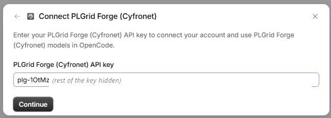

### 2e. Choose the model

Expected result: the window **Connected to PLGrid Forge (Cyfronet)** with the
two models, and a message in the corner *PLGrid Forge (Cyfronet) connected*.
Keep **DeepSeek V4.1 Flash (PLGrid)** ticked and click **Continue**.

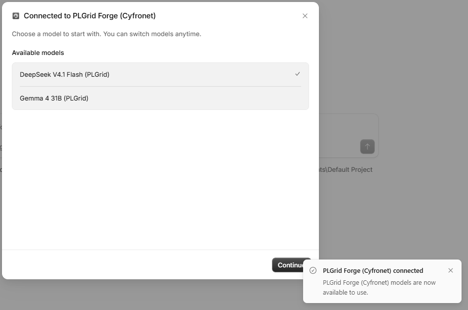

## Step 3. Check that it works

Under the text box you now see **PLGrid Forge (Cyfronet) / DeepSeek V4.1 Flash
(PLGrid)**. Type `hi` and press **Enter**.

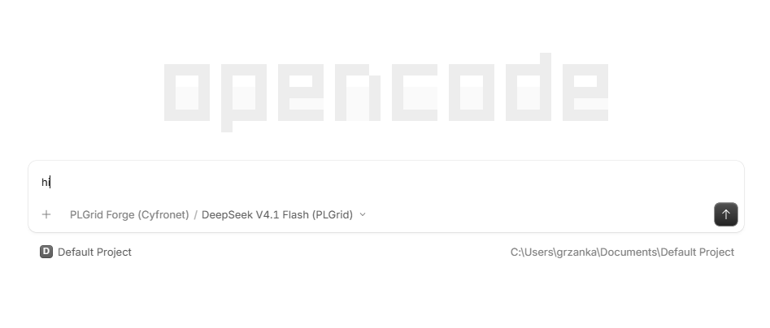

Expected result: within a few seconds, a short answer such as *Hi! How can I
help you today?* This answer came from llmlab, and used a few of your credits.

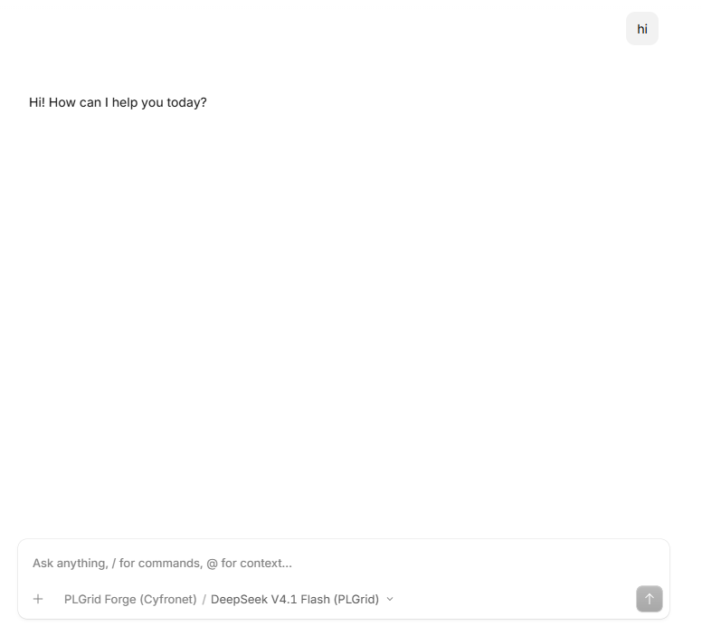

> [!IMPORTANT]
> Always check that the model name under the text box starts with
> **PLGrid Forge (Cyfronet)**. The model list also contains free models run by
> opencode, among them a **DeepSeek V4.1 Flash Free**. Your text goes to the
> service you pick.

Errors

- **PLGrid Forge (Cyfronet)** is not found in step 2c: opencode did not read the
  settings file. Go back to [part 1](03-configure-llmlab-endpoint.md), step 4,
  then close opencode completely and start it again.
- *Not authenticated*, *401* or *Unauthorized*: the key is wrong or incomplete.
  Repeat step 2 and paste the key again. If you lost the key, generate a new one
  (step 1).
- *not available for grant*: your grant cannot use DeepSeek. Click the model
  name under the text box and pick **Gemma 4 31B (PLGrid)**. See
  [Which model](05-first-steps.md#which-model).

Where opencode keeps the settings and the key, how to find these files and how
to remove everything, and other ways to give opencode the key, are described in
[7. For experts: other ways to set up](07-for-experts.md).

## Sources

- PLGrid Forge official guide:
  <https://guide.plgrid.pl/en/integrated-platforms/plgrid_forge>

The model list and access rules change over time. Check
<https://llmlab.plgrid.pl> for the current state.

---

← Previous: [3. Configure opencode for llmlab, part 1: the address](03-configure-llmlab-endpoint.md) · [Docs overview](README.md) · Next: [5. First steps in opencode →](05-first-steps.md)
