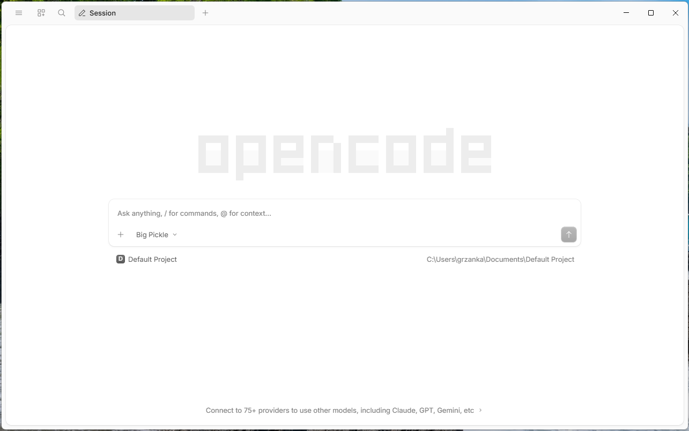
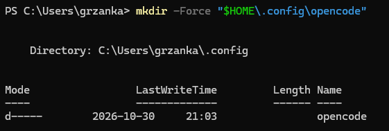

# 4. Connect opencode to llmlab

This page shows, with screenshots, how to set up the opencode desktop app on
Windows so that it uses models from [PLGrid Forge (llmlab)](03-get-llmlab-access.md).
You need the opencode app ([page 2](02-install-opencode.md)) and your llmlab API
key ([page 3](03-get-llmlab-access.md)).

## Step 1. Open opencode

Start opencode from the Start menu. Not installed yet? See
[2. Install the opencode app](02-install-opencode.md).

Expected result: a window with the large **opencode** logo and a text box that
says *Ask anything, / for commands, @ for context...*. Below the box you see the
current project (**Default Project**), and at the bottom a link
*Connect to 75+ providers to use other models*.



The model shown under the text box (here **Big Pickle**) is a free default
model. It is not llmlab yet. The next steps change that.

The opencode app has no screen where you can type the llmlab address. Instead,
you download a small ready-made settings file from this course repository.
You do not need Git.

## Step 2. Open PowerShell

Press the **Windows** key, type `PowerShell`, and press **Enter**. A window with
a blinking cursor opens. This is a terminal: you type a command, press
**Enter**, and the computer runs it.

## Step 3. Download the settings file

This step has three commands: create a folder, download the file into it, and
check the file.

### 3a. Create the folder

opencode reads its settings from one fixed place in your user folder:
`.config\opencode\opencode.json`. On a new computer the `.config\opencode`
folder does not exist yet. The download in 3b only saves a file; it does not
create missing folders, and fails if the folder is not there. So create it first:

```powershell
mkdir -Force "$HOME\.config\opencode"
```

`$HOME` is your user folder, for example `C:\Users\yourname`. `-Force` means:
create the folder, and do not complain if it already exists.

Expected result (with your own user name and date):

<!-- Trying two ways to show output without a copy button: <pre> and a screenshot. Keep one. -->

<pre>
    Directory: C:\Users\yourname\.config


Mode                 LastWriteTime         Length Name
----                 -------------         ------ ----
d-----        2026-10-30     21:03                opencode
</pre>



### 3b. Download the file

```powershell
curl.exe -fLo "$HOME\.config\opencode\opencode.json" https://raw.githubusercontent.com/grzanka/kisd-2026-agents-coding/lecture-content-setup/config/opencode.json
```

Expected result: a small progress table. The first column of the last line is
`100` (100% downloaded). The other numbers may differ:

```text
  % Total    % Received % Xferd  Average Speed  Time    Time    Time   Current
                                 Dload  Upload  Total   Spent   Left   Speed
100    960 100    960   0      0   2202      0                              0
```

Type `curl.exe`, not `curl`: in Windows PowerShell, `curl` is a different
command. `curl.exe` is part of Windows 10 (since 2018) and Windows 11.

<details>
<summary>Explain: what does <code>-fLo</code> mean?</summary>

- `-f` (fail): if the server answers with an error, stop and say so, instead of
  saving the error page as your settings file.
- `-L` (location): follow a redirect if the server sends one.
- `-o` (output): save to this file instead of printing it on the screen.

</details>

<details>
<summary>No <code>curl.exe</code>? Use one of these instead</summary>

If you see *curl.exe is not recognized*, your Windows is older than 2018. Use
the PowerShell download command instead. It works on every Windows:

```powershell
Invoke-WebRequest -Uri "https://raw.githubusercontent.com/grzanka/kisd-2026-agents-coding/lecture-content-setup/config/opencode.json" -OutFile "$HOME\.config\opencode\opencode.json"
```

Expected result: no output, the cursor just returns.

Or download it with a web browser: open the address above, press **Ctrl+S**,
and save it as `opencode.json` in `C:\Users\yourname\.config\opencode`. Set
*Save as type* to **All files**, otherwise Windows may name it
`opencode.json.txt`, and opencode will not find it.

</details>

### 3c. Check the file

Show the content of the file on the screen:

```powershell
Get-Content "$HOME\.config\opencode\opencode.json"
```

Expected result: the settings text, starting like this:

```text
{
  "$schema": "https://opencode.ai/config.json",
  "model": "plgrid/deepseek-ai/DeepSeek-V4.1-Flash",
  "small_model": "plgrid/google/gemma-4-31B",
  "provider": {
    "plgrid": {
      "npm": "@ai-sdk/openai-compatible",
      "name": "PLGrid Forge (Cyfronet)",
      "env": ["PLGRID_API_KEY"],
      "options": {
        "baseURL": "https://llmlab.plgrid.pl/api/v1"
```

> [!WARNING]
> If you already had your own `opencode.json` in that folder, this command
> replaces it. Most participants do not have one.

<details>
<summary>Explain: what is in the file?</summary>

The file [config/opencode.json](../config/opencode.json) tells opencode:

- the address of llmlab: `https://llmlab.plgrid.pl/api/v1`;
- two models, with their limits (how much text each can read and write at once):
  `deepseek-ai/DeepSeek-V4.1-Flash` as the default, and `google/gemma-4-31B`
  as a fallback;
- to use Gemma for the short session titles, so no text goes to opencode's
  free models;
- where to find your API key: either saved in the opencode app, or in a Windows
  setting called `PLGRID_API_KEY` (next step). The key itself is never written
  in this file.

</details>

<details>
<summary>Errors</summary>

- *Failed to open the file ... No such file or directory* or *curl: (23)*: the
  folder does not exist. Run 3a, then download again.
- *Could not resolve host* or a timeout: check your internet connection.
- *The requested URL returned error: 404*: the address was not copied in full.
  Copy the whole block again.

</details>

## Step 4. Store your API key

You get the key on <https://llmlab.plgrid.pl> under **Grants → Generate API Key**
(see [3. Get access to llmlab](03-get-llmlab-access.md)).

opencode looks for the key in two places. Use **one** of them.

<!-- TODO: option A not yet tested in the desktop app; add screenshots. -->

### Option A: paste the key in the opencode app

1. Start opencode from the Start menu.
2. Open the model list under the text box and click **See 70+ more providers**.
3. In the **Integrations** search box, type `plgrid`.
4. Click **PLGrid Forge (Cyfronet)**, choose **API key**, paste your key, and confirm.

Expected result: the model name under the text box changes to
**DeepSeek V4.1 Flash (PLGrid)**. Go on with step 5; you do not need to restart.

If **PLGrid Forge (Cyfronet)** does not appear in the search, step 3 did not
work, or your version of opencode does not offer this. Use option B.

### Option B: save the key as a Windows setting

Close opencode first. In PowerShell, run the command below. Replace
`paste-your-key-here` with your key and keep the quotes:

```powershell
setx PLGRID_API_KEY "paste-your-key-here"
```

Expected result:

```text
SUCCESS: Specified value was saved.
```

This saves the key as a Windows setting for your user account (an
*environment variable*). Programs started from now on can read it; programs
already open cannot. That is why opencode must be closed during this step.

<details>
<summary>Linux / macOS</summary>

Add this line to `~/.bashrc` or `~/.zshrc`, then open a new terminal:

```bash
export PLGRID_API_KEY="paste-your-key-here"
```

The settings file goes to `~/.config/opencode/opencode.json`:

```bash
curl -fL --create-dirs -o ~/.config/opencode/opencode.json https://raw.githubusercontent.com/grzanka/kisd-2026-agents-coding/lecture-content-setup/config/opencode.json
```

</details>

## Step 5. Start opencode again

Start opencode from the Start menu.

Expected result: under the text box you see **DeepSeek V4.1 Flash (PLGrid)**
instead of **Big Pickle**.

> [!IMPORTANT]
> The model list also contains a free **DeepSeek V4.1 Flash** run by opencode,
> not by PLGrid. Use only the one that ends with **(PLGrid)**.

Type a short question, such as `What is 2 + 2?`, and send it. You should get
an answer within a few seconds.

<details>
<summary>Errors</summary>

- *Big Pickle* is still selected: opencode did not read the file. Check step 3,
  then close opencode completely and start it again.
- *401* or *Unauthorized*: the key is wrong, or (option B) opencode was open
  during step 4. Repeat step 4, then restart opencode. On some computers you need to sign out
  of Windows and sign in again.
- *not available for grant*: your grant cannot use DeepSeek. Click the model
  name under the text box and pick **Gemma 4 31B (PLGrid)**. See
  [Which model](05-first-steps.md#which-model).

</details>

## Summary: what is now on your computer

The settings and the key are kept in different places. `yourname` stands for your
Windows user name.

| What | Where | Created by |
|---|---|---|
| Settings: llmlab address and models | `C:\Users\yourname\.config\opencode\opencode.json` | Step 3 |
| API key, option A | A file in `C:\Users\yourname\.local\share\opencode\`: `auth.json` or `opencode.db`, depending on the opencode version | opencode, in step 4 |
| API key, option B | Not a file: a Windows setting (environment variable) `PLGRID_API_KEY` of your user account | `setx` in step 4 |

The settings file has no secrets in it. The key is stored as plain text, so do
not share the `.local` folder or send its files to anyone.

You will not normally see these folders. File Explorer opens on *This PC*,
*Desktop* or *Documents*, and these folders sit one level up, directly in your
user folder. Their names start with a dot, which is the Linux and macOS way of
marking hidden folders; there they are hidden, and that habit came to Windows
with programs like opencode.

To open the settings folder in File Explorer, press **Windows+R**, paste this,
and press **Enter**:

```text
%USERPROFILE%\.config\opencode
```

<details>
<summary>Linux / macOS</summary>

The same paths, starting with `~` instead of `C:\Users\yourname`:
`~/.config/opencode/opencode.json` and `~/.local/share/opencode/`. Folders
starting with a dot are hidden; list them with `ls -a`, or press
**Cmd+Shift+.** in the macOS Finder. Option B lives in `~/.bashrc` or
`~/.zshrc`.

</details>

<details>
<summary>Remove everything</summary>

Delete the folder `C:\Users\yourname\.config\opencode`, and the folder
`C:\Users\yourname\.local\share\opencode`. The second one also holds your
saved opencode sessions, so they are gone too. If you used option B, remove the
setting:

```powershell
[Environment]::SetEnvironmentVariable("PLGRID_API_KEY", $null, "User")
```

</details>

---

← Previous: [3. Get access to llmlab](03-get-llmlab-access.md) · [Docs overview](README.md) · Next: [5. First steps in opencode →](05-first-steps.md)
