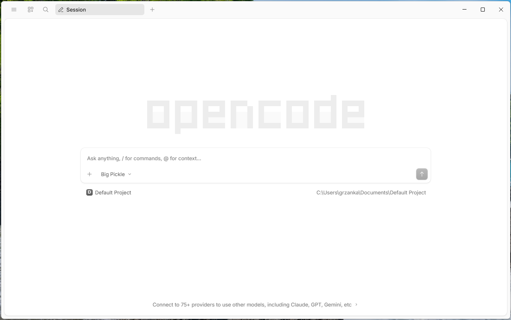

# Step by step: connect the opencode app to llmlab

This page shows, with screenshots, how to set up the opencode desktop app on
Windows so that it uses models from [PLGrid Forge (llmlab)](plgrid-forge.md).

## Step 1. Open opencode

Start opencode from the Start menu.

Expected result: a window with the large **opencode** logo and a text box that
says *Ask anything, / for commands, @ for context...*. Below the box you see the
current project (**Default Project**), and at the bottom a link
*Connect to 75+ providers to use other models*.



The model shown under the text box (here **Big Pickle**) is a free default
model. It is not llmlab yet. The next steps change that.

The opencode app has no screen where you can type the llmlab address. Instead,
you download a small ready-made settings file from this course repository.
You do not need Git.

Close opencode before you continue.

## Step 2. Open PowerShell

Press the **Windows** key, type `PowerShell`, and press **Enter**. A window with
a blinking cursor opens. This is a terminal: you type a command, press
**Enter**, and the computer runs it.

## Step 3. Download the settings file

Create the folder where opencode looks for its settings:

```powershell
mkdir -Force "$HOME\.config\opencode"
```

Expected result: a short table with the folder name `opencode`. If the folder
already exists, you see the same table; that is fine.

Download the settings file into that folder:

```powershell
curl.exe -fLo "$HOME\.config\opencode\opencode.json" https://raw.githubusercontent.com/grzanka/kisd-2026-agents-coding/lecture-content-setup/config/opencode.json
```

Expected result: a short progress table that ends with `100`. Type `curl.exe`,
not `curl`: in Windows PowerShell, `curl` is a different command.

Check that the file is there:

```powershell
Get-Content "$HOME\.config\opencode\opencode.json"
```

Expected result: text that contains `https://llmlab.plgrid.pl/api/v1`.

> [!WARNING]
> If you already had your own `opencode.json` in that folder, this command
> replaces it. Most participants do not have one.

<details>
<summary>Explain: what is in the file?</summary>

The file [config/opencode.json](../config/opencode.json) tells opencode:

- the address of llmlab: `https://llmlab.plgrid.pl/api/v1`;
- two models, with their limits (how much text each can read and write at once):
  `deepseek-ai/DeepSeek-V4.1-Flash` as the default, and `google/gemma-4-31B`
  as a fallback;
- to use Gemma for the short session titles, so no text goes to opencode's
  free models;
- to read your API key from a setting called `PLGRID_API_KEY` (next step), so
  the key itself is never written in the file.

</details>

<details>
<summary>Errors</summary>

- *Failed to create the file* or *No such file or directory*: the `mkdir`
  command was skipped. Run it, then download again.
- *Could not resolve host* or a timeout: check your internet connection.
- *The requested URL returned error: 404*: the address was not copied in full.
  Copy the whole block again.

</details>

## Step 4. Store your API key

You get the key on <https://llmlab.plgrid.pl> under **Grants → Generate API Key**
(see [PLGrid Forge](plgrid-forge.md#1-get-access)).

In PowerShell, run the command below. Replace `paste-your-key-here` with your key
and keep the quotes:

```powershell
setx PLGRID_API_KEY "paste-your-key-here"
```

Expected result:

```text
SUCCESS: Specified value was saved.
```

This saves the key as a Windows setting for your user account (an
*environment variable*). Programs started from now on can read it; programs
already open cannot. That is why opencode must be closed during this step.

<details>
<summary>Linux / macOS</summary>

Add this line to `~/.bashrc` or `~/.zshrc`, then open a new terminal:

```bash
export PLGRID_API_KEY="paste-your-key-here"
```

The settings file goes to `~/.config/opencode/opencode.json`:

```bash
curl -fL --create-dirs -o ~/.config/opencode/opencode.json https://raw.githubusercontent.com/grzanka/kisd-2026-agents-coding/lecture-content-setup/config/opencode.json
```

</details>

## Step 5. Start opencode again

Start opencode from the Start menu.

Expected result: under the text box you see **DeepSeek V4.1 Flash (PLGrid)**
instead of **Big Pickle**.

> [!IMPORTANT]
> The model list also contains a free **DeepSeek V4.1 Flash** run by opencode,
> not by PLGrid. Use only the one that ends with **(PLGrid)**.

Type a short question, such as `What is 2 + 2?`, and send it. You should get
an answer within a few seconds.

<details>
<summary>Errors</summary>

- *Big Pickle* is still selected: opencode did not read the file. Check step 3,
  then close opencode completely and start it again.
- *401* or *Unauthorized*: the key is wrong, or opencode was open during step 4.
  Repeat step 4, then restart opencode. On some computers you need to sign out
  of Windows and sign in again.
- *not available for grant*: your grant cannot use DeepSeek. Click the model
  name under the text box and pick **Gemma 4 31B (PLGrid)**. See
  [Which model](plgrid-forge.md#3-which-model).

</details>

[← Back to the docs](README.md)
