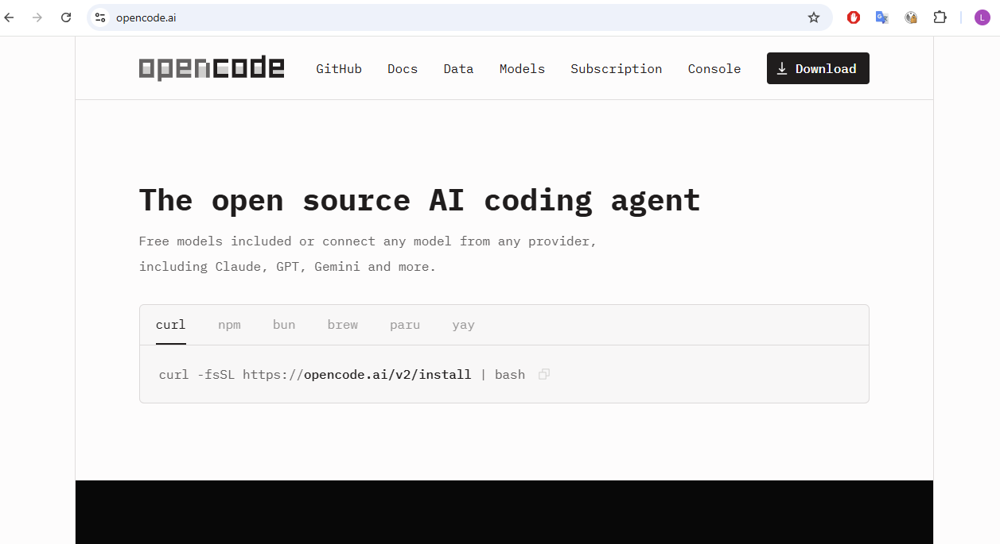
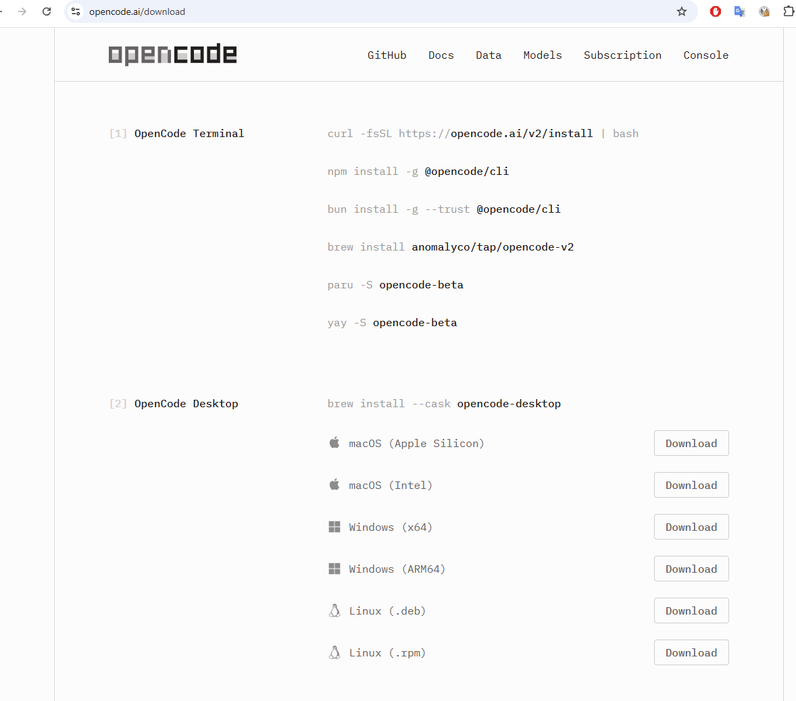

# What is opencode

opencode is an **AI coding agent**. You describe a task in plain language, for
example "load `results.csv` and plot the mean per group", and the agent reads
your files, writes and runs code, looks at the output and fixes its own mistakes
until the task is done. It asks before it does anything risky.

In this course we use the **opencode desktop app**: you install it and start it
like any other program, from the Start menu (Windows), Launchpad (macOS) or the
application menu (Linux). It uses models hosted on the PLGrid supercomputers
(see [PLGrid Forge](plgrid-forge.md)).

<details>
<summary>Explain: agent, model, terminal</summary>

- **Model** (large language model, LLM): the program that reads text and writes
  text. On its own it can only answer.
- **Agent**: a program that gives a model tools (read a file, run a command, edit
  a file) and lets it use them in a loop until the task is finished.
- **Terminal**: a window where you type commands instead of clicking. opencode
  also exists as a terminal program. We do not use it in this course.

</details>

## Install the desktop app

Open your web browser and go to <https://opencode.ai/>.



> [!WARNING]
> Do **not** run the command shown on the home page
> (`curl -fsSL https://opencode.ai/v2/install | bash`), or any other command
> from the list. They install the **terminal** version of opencode. We use the
> **desktop** app.

Click **Download** in the top right corner. The download page has two parts.
Skip **[1] OpenCode Terminal**. Go to **[2] OpenCode Desktop** and click
**Download** in the row for your computer:



| Your computer | Row to choose |
|---|---|
| Most Windows laptops and desktops | **Windows (x64)** |
| Windows on a Snapdragon processor (some laptops from 2024 on) | **Windows (ARM64)** |
| Mac from late 2020 on, with an M1, M2, M3, M4… chip | **macOS (Apple Silicon)** |
| Older Mac with an Intel processor | **macOS (Intel)** |
| Ubuntu, Debian, Linux Mint | **Linux (.deb)** |
| Fedora, Red Hat, openSUSE | **Linux (.rpm)** |

Not sure which one you have? Read the two explanations below.

Open the downloaded file and follow the installer.

- **Windows:** the file is in your *Downloads* folder. Double-click it. If you see
  *Windows protected your PC*, check that you downloaded the file from
  opencode.ai, then click **More info → Run anyway**.
- **macOS:** open the downloaded file and drag opencode into *Applications*.
- **Linux:** open the file with your software installer, or install it from the
  terminal with your package manager.

Expected result: you can find **opencode** in the Start menu (Windows),
Launchpad (macOS) or the application menu (Linux). When you start it, you see
the opencode start screen. Continue with
[Step by step: connect the opencode app to llmlab](opencode-llmlab-setup.md).

<details>
<summary>Explain: Apple Silicon or Intel (Mac)?</summary>

The processor is the chip that runs all programs. A program is built for one
type of processor, so you need the matching download.

From 2006 to 2020, every Mac had an **Intel** processor, the same kind as in
most Windows PCs. In November 2020 Apple started to use its own chips, called
**Apple Silicon**: M1, then M2, M3, M4 and newer. They are related to the chips
in iPhones. By 2023 every new Mac had one. A MacBook Air bought in 2021 has an
M1 chip; a MacBook Pro from 2019 has an Intel processor.

To check: click the **Apple menu** in the top left corner, then **About This
Mac**. If you see *Chip: Apple M…*, choose **Apple Silicon**. If you see
*Processor: … Intel Core i5* (or i7, i9), choose **Intel**.

</details>

<details>
<summary>Explain: x64 or ARM64 (Windows)?</summary>

These are two families of processors.

- **x64** (also called x86-64 or AMD64) is the family of Intel and AMD
  processors, for example *Intel Core i5* or *AMD Ryzen 7*. It goes back to the
  first PC processors of the 1980s (Intel 8086, hence "x86"); AMD extended it to
  64 bits in 2003. Almost all Windows computers use it.
- **ARM64** is the family used in phones and tablets. It uses less power, so the
  battery lasts longer. Windows laptops with ARM processors became common in
  2024 with the **Qualcomm Snapdragon X** chips, in "Copilot+ PC" models such as
  Microsoft Surface Laptop 7 or some Lenovo, Dell, HP and ASUS laptops.

To check: open **Settings → System → About** and look at **System type**. It
says *x64-based processor* or *ARM-based processor*. If you are not sure, choose
**x64**: ARM laptops can run x64 programs too, only a bit slower.

</details>

## Why opencode and not Claude Code

Claude Code is Anthropic's coding agent. It looks and works much like opencode:
both read and edit your files, run commands and ask for permission. The main
difference is **which models they can use**.

- opencode is **open source** and works with **many model providers**, including
  PLGrid Forge. You pay only for the model, here with credits from your PLGrid
  grant, and your data stays on PLGrid hardware.
- Claude Code works only with **Anthropic's Claude models** and needs a paid
  Claude subscription or API account. Your data is sent to Anthropic.

## Side by side

| | opencode | Claude Code |
|---|---|---|
| Made by | Anomaly, open source (MIT licence) | Anthropic, proprietary |
| Models | Any provider: PLGrid Forge, OpenAI, local models, Claude… | Claude models only |
| Cost | Tool is free; you pay the model provider | Claude subscription or API billing |
| Where your data goes | To the provider you choose (here: PLGrid) | To Anthropic |
| Project instructions file | `AGENTS.md` (reads `CLAUDE.md` if there is no `AGENTS.md`) | `CLAUDE.md` |
| Settings file | `opencode.json` | `.claude/settings.json` |
| Plan first, then build | **Tab** switches between the `plan` and `build` agents | **Shift+Tab** cycles modes, including plan mode |
| Create the instructions file | `/init` | `/init` |
| Choose a model | `/models` | `/model` |
| Undo the last change | `/undo` (needs a Git repository) | `/rewind`, or **Esc** twice |
| Windows | Desktop app and terminal | Desktop app and terminal |

What to expect in practice: the open models on PLGrid are good, but usually
weaker than Anthropic's best Claude models at long, multi-step tasks. Give
smaller tasks, and **always check the results** (numbers, plots, file contents)
yourself.

## Basic use

Start opencode from the Start menu, like any other program.

Expected result: the opencode window opens, with a text box in the middle and
the model name under it. Under the text box you also see the project, that is
the folder opencode works in.

Type a task in the text box and press **Enter**. Start with a question that
changes nothing:

```text
What files are in this folder, and what do they contain?
```

Useful keys and commands in the text box (type `/` to see them all):

- **Tab**: switch between `plan` (only reads and proposes) and `build` (makes
  changes). Use `plan` first when you are unsure what the agent will do.
- `/models`: pick another model.
- `/init`: let the agent write an `AGENTS.md` that describes your project. opencode
  reads this file at the start of every session.
- `/undo`: take back the last message and its file changes.

<details>
<summary>Going further</summary>

- Ask a helper agent for a side task with `@`, for example
  `@general find where the plots are saved`.
- The terminal version of opencode (the `opencode` command) uses the same
  settings file and the same models. It is handy for scripts, for example
  `opencode run "summarise data.csv"`.
- Two major versions exist, 1.x and 2.x. This course uses the current desktop
  app from opencode.ai.

</details>

## Sources

- opencode documentation: <https://opencode.ai/docs>
- opencode download page: <https://opencode.ai/download>
- opencode source code: <https://github.com/anomalyco/opencode>
- Claude Code documentation: <https://code.claude.com/docs>
